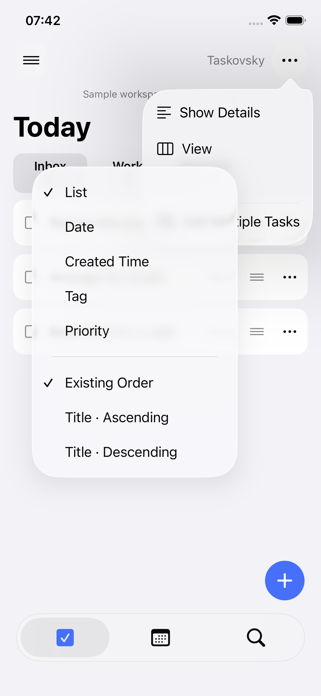
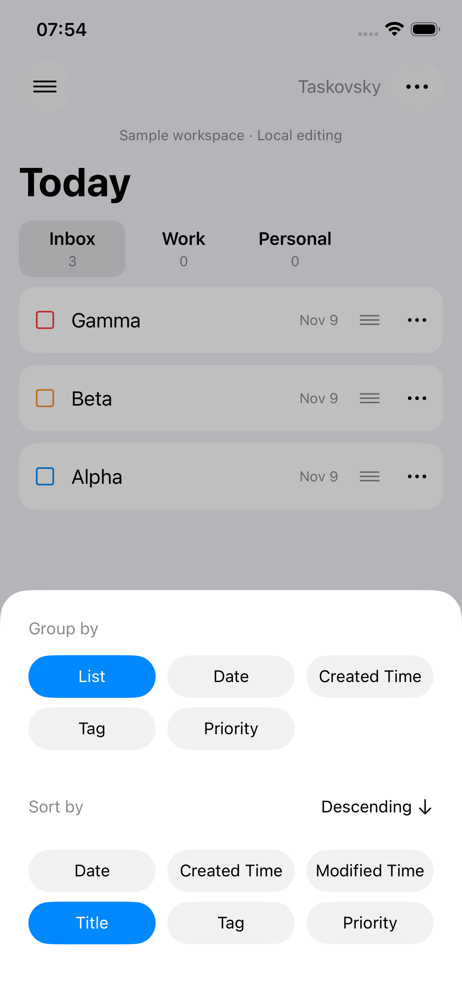

# T04 Kanban Group & Sort reference-structured sheet

## User-prioritized correction

The user requested verification of PR149 against live mobile TickTick, matching positions, sizes and labels and removing nonexistent controls. This supersedes further D10 implementation for this slice. Baseline PR149 rendered a tall native popup menu with Existing Order and combined Title direction choices. A same-viewport owned Simulator baseline screenshot was captured before changes.

The restored, read-only live reference audit found a rounded white bottom sheet occupying approximately 41% of the viewport, no title/Done/drag handle/footer/reset. Group by: List, Date, Created Time / Tag, Priority in a three-column pill grid. Sort by: Date, Created Time, Modified Time / Title, Tag, Priority, with Ascending/Descending and arrow at the header's right. Selected pills are blue/white without checkmark; other pills pale gray/dark. Choosing a group/sort keeps the sheet open and changes the content behind it. Direction survives changing sort. Tapping the backdrop dismisses. Private TickTick screenshots remain withheld.

## Implementation contract

- Dedicated bottom overlay with explicit tappable dimmed backdrop, rounded top corners, no extra title/buttons/footer/handle. Height approximately 41%, minimum 330pt to retain usable standard-size controls; matching is normalized, not calibrated pixel-perfect.
- Three equal columns, 10pt column gap, 36pt visible rounded pills inside 44pt hit areas, 14pt labels, 24pt side/top inset. Direction has a full 44pt hit row with no overlapping grid hit area. Current semantic light/dark colors remain supported; dark matching remains deferred.
- Freeze the destination in the presentation request. Immediate session bindings do not close the sheet, mutate data, change List preferences or redirect choices to another destination. Existing incoming order remains until first actual sort selection; no fabricated selected pill or visible Existing Order/reset. Direction defaults ascending and remains per destination across choices.
- All six choices have genuine behavior. Date uses existing schedule/display-date policy (missing last), Created/Modified compare actual timestamps, Title uses existing numeric case/diacritic-insensitive comparator, Priority uses existing rank. Equal keys retain incoming order in both directions. These are Taskovsky policies, not exact reference tie/collation claims.
- Tag creates real collapsible subsections inside each existing lane. Stable lane+tag IDs isolate collapse state and accessibility identifiers; duplicate tag names remain distinct. Primary known tag is inherited Taskovsky policy, one card per task. Named sections follow direction, unknown/no tags remain last, secondary row order remains incoming. Exact TickTick multi-tag/secondary semantics are unverified. Collapse survives direction changes, clears on grouping change and prunes removed section keys.
- Date/List move/drop semantics still target the outer lane. Tag subsections are not drop targets; metadata-only lanes remain read-only. Ordinary list status/section boards and their styling are unchanged.

## Verification and visual comparison

Final production source `c912bfe` independently reviewed with no remaining source blocker.

- Full final suite: 906 XCTest plus 38 Swift tests passed. Release build passed. Corrected iPhone native invocation compiled final source/tests.
- Owned iPhone 13 Pro, iOS 26.3.1: `KanbanSheetNative2.xcresult` completed, exit 0, six tests passed, zero failures/skips. Actual all-six-sort outcomes; all five group pills; same open sheet; direction preservation; backdrop dismissal; Tag section collapse/direction preservation; lane removal; actual Date range move/Undo and List drag restoration passed.
- Initial six-test run had five passes and a real 17pt direction accessibility hit-frame failure. Added the label content shape inside its 44pt frame, kept the assertion, and the complete six-test rerun passed. No acceptance weakening. Modal accessibility Escape is retained in source; VoiceOver gesture itself was not automated.
- Six UIKit `_UIReparentingView` warnings from existing native overflow menus remain disclosed, not claimed fixed.
- Hosted CI for the exact published head remains required before merge.

Both baseline and after screenshots are genuine, inspected, neutral owned-Simulator captures at 1170×2532 pixels (390×844 points). The reference was a 300×650 mirrored viewport, so the comparison is normalized rather than a calibrated pixel diff. Different task fixtures do not affect the isolated form geometry.

| Element | Observed reference normalized to 390pt width | Taskovsky after |
| --- | --- | --- |
| Bottom sheet height | approximately 41% viewport | approximately 41% viewport |
| Left content inset | approximately 24.7pt | 24pt |
| Pill width × height | approximately 105.3×35.1pt | approximately 107×36pt |
| Horizontal gap | approximately 10.4–11.7pt | 10pt |
| Sort heading offset below top | approximately 178pt | approximately 179pt |
| Selected state | blue/white, no check | blue/white, no check |
| Extra controls | no title/Done/handle/footer/reset | none |

Exact font rendering/color values and unobserved Tag secondary/multi-tag semantics are not certified. Existing accessibility support is retained; accessibility-specific layout/dark-theme polishing remains deferred.

| Before PR149 correction | After |
| --- | --- |
|  |  |

### Integration with PR150

Merged current main `d41ee5f` into this branch at `c9e6072`. Independent actual integration review verified unchanged Kanban production source, preservation of both native test groups, C10/T04 tracker rows, receipts, manifests and assets. Calendar style changes are separate; no additional native rerun was required solely for the merge. Integrated full suite passed 915 XCTest plus 38 Swift tests; release and iPhone build-for-testing passed (all completed, exit 0). Refreshed exact-head hosted CI remains required.
