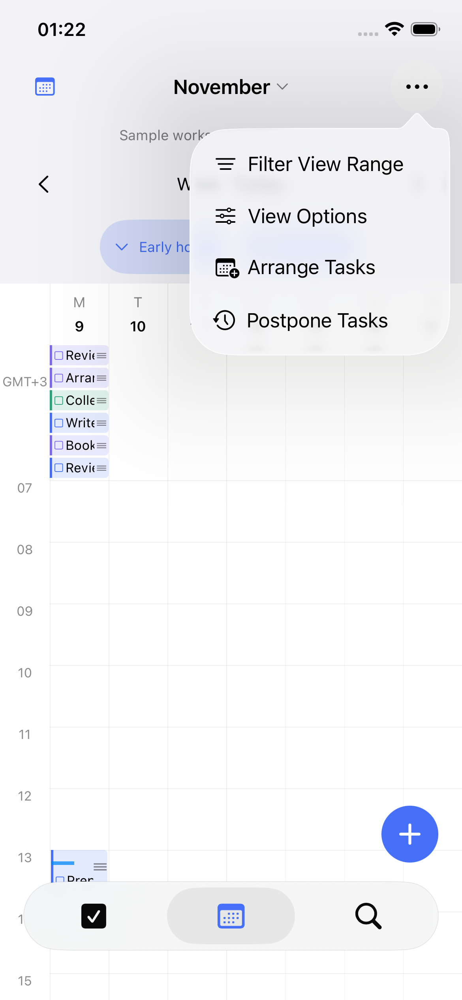
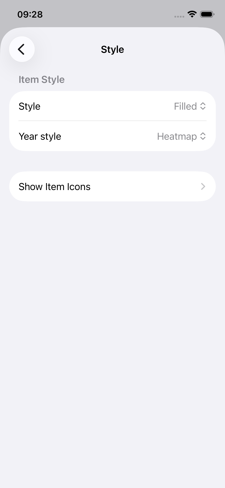
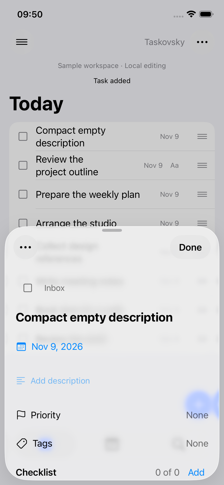
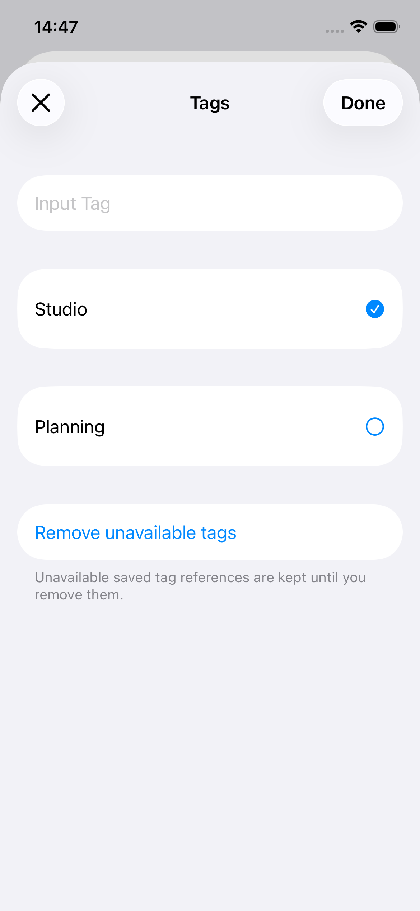
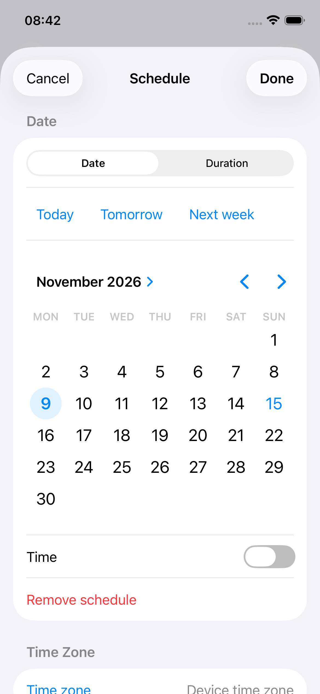
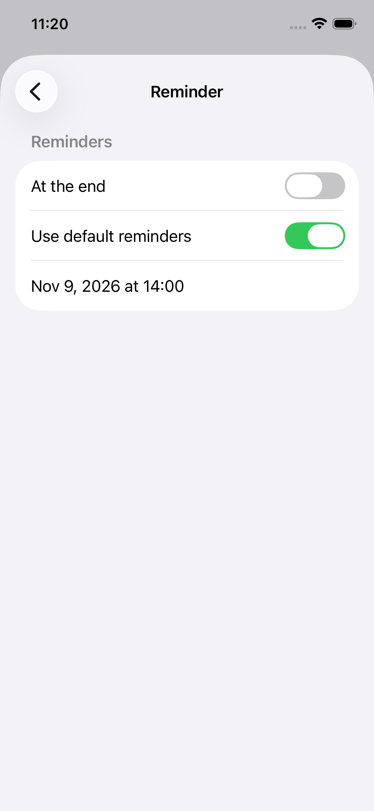
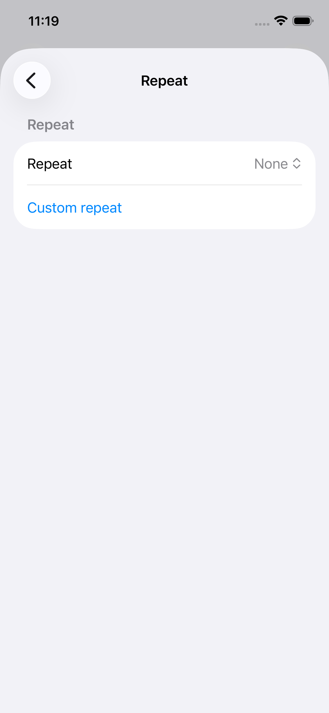
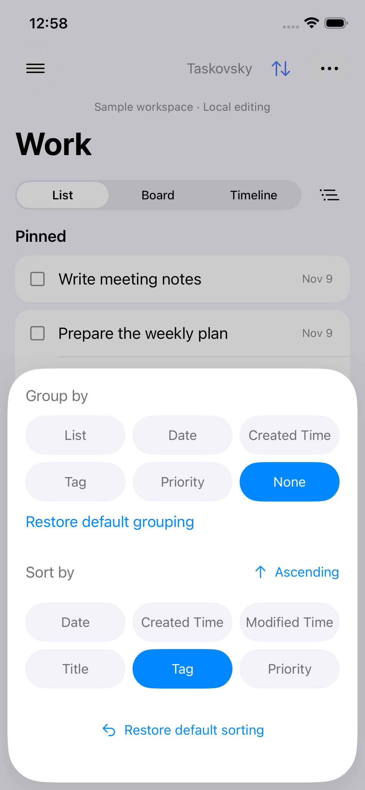

# Mobile visual parity tracker

Updated: **2026-11-15**. Assessment baseline: main `0cbe459` (includes PR115 and scope PR117; plus PR116 empty-description delta). **General similarity, not pixel certification.**

This tracks all **46 original observed states**: 15 Calendar, 14 detail/scheduling, 17 Tasks. **10 broadly similar, 34 partial, 2 explicitly deferred.** None is certified pixel-perfect. A counterpart existing does not mean its layout or behavior is complete.

## How to read and maintain

- **Similar**: the general purpose and structure are present, with explicit remaining differences. Not “finished.”
- **Partial**: a counterpart exists but a significant layout, navigation or control gap remains.
- **Deferred**: outside current core completion gates by user direction.
- **Screenshot missing** means no inspected publishable asset attached here, not that the feature is absent.
- These are provisional assessments from merged feature receipts/source and the live reference inventory, not a fresh matched audit of every state.
- **Wide-first:** prioritize major missing structures across core forms before fine pixel polishing. Preserve existing accessibility support; accessibility-specific layouts, Dark and persistence polishing are deferred.
- For each completed UI PR, update affected row, remaining gap, PR/receipt and actual screenshot. Record the captured build; do not label an old screenshot as current. Only compare matched fixture, viewport, theme and text size before upgrading visual acceptance.

## Per-form implementation requirement

Follow the [element and behavior contract](changes/mobile-live-parity-plan-2026-11-14.md#per-form-element-and-behavior-contract): inventory every element in each active form, its position/size, exact observed wording, UX and underlying business logic, with evidence and unknowns explicit. Link each bounded element table and verification receipt from its affected state. Broad major similarity across forms comes first, including complete working elements and comparable layout; near-pixel-perfect polishing is the final stage. Existing row assessments are unchanged by this planning update and are not proof that these expanded element checks have been completed. Retain the two explicitly deferred states and all other current scope deferrals.

## Reading the comparison

Each state has adjacent **TickTick reference** and **Taskovsky screenshot** cells. Existing genuine captures render inline at 180 px wide; click for full resolution. Empty cells explicitly name the missing evidence. No reference images or substitute mockups have been invented. The gallery below retains per-capture provenance.

## Evidence coverage and limits

**14/46 states have an attached Taskovsky screenshot; 32/46 await one. 0/46 have a portable TickTick reference image attached here.** All sixteen assets are unmodified, pixel-inspected owned Simulator QA captures with neutral sample content or settings. They are historical feature-checkpoint images, **not a new capture of baseline main**. C04 in particular predates subsequent Calendar layout changes.

The real TickTick images from the original audit remain in its Computer Use trace, not as durable publishable PNGs. See the [reference inventory](ticktick-spec/mobile-surface-inventory-2026-11-14.md) for observed hierarchy and trace locators. Do not infer visual equality from a missing reference image. Future reference attachments require a matched safe fixture and privacy review; no personal task/account screenshots are published here.

The [prioritized implementation plan](changes/mobile-live-parity-plan-2026-11-14.md) remains the work queue. Additional known modes outside the original 46 must be tracked separately rather than silently changing this denominator.

## Calendar

| ID | Form / state | General similarity | Biggest remaining gap | TickTick reference | Taskovsky screenshot |
|---|---|---|---|---|---|
| C01 | Hourly Week | Partial | Header, density, overlaps and gestures still need matched comparison. | **Screenshot missing** [Observed reference inventory](ticktick-spec/mobile-surface-inventory-2026-11-14.md) | **Screenshot missing** Awaiting an inspected capture. |
| C02 | Calendar mode menu | Similar | Core chooser and 3 Day exist; naming and order still differ. | **Screenshot missing** [Observed reference inventory](ticktick-spec/mobile-surface-inventory-2026-11-14.md) | **Screenshot missing** Awaiting an inspected capture. |
| C03 | Week overview | Similar | Mini-month, seven tiles and Day/Back implemented; geometry remains approximate. | **Screenshot missing** [Observed reference inventory](ticktick-spec/mobile-surface-inventory-2026-11-14.md) |  [PR #112](https://github.com/Mental-NV/Taskovsky/pull/112) · [Capture details](#evidence-c03) Historical QA; not current-main capture. |
| C04 | Calendar overflow menu | Partial | Core routes exist; subscriptions excluded and Share/Print deferred. | **Screenshot missing** [Observed reference inventory](ticktick-spec/mobile-surface-inventory-2026-11-14.md) |  [PR #103](https://github.com/Mental-NV/Taskovsky/pull/103) · [Capture details](#evidence-c04) Historical QA; not current-main capture. |
| C05 | Filter View Range | Partial | Source/tag filters exist; hierarchy, layout and option inventory differ. | **Screenshot missing** [Observed reference inventory](ticktick-spec/mobile-surface-inventory-2026-11-14.md) | **Screenshot missing** Awaiting an inspected capture. |
| C06 | View Options | Partial | Nested Color/Style exist; remaining settings structure differs. | **Screenshot missing** [Observed reference inventory](ticktick-spec/mobile-surface-inventory-2026-11-14.md) | **Screenshot missing** Awaiting an inspected capture. |
| C07 | Color settings | Partial | List/tag/priority/custom colors work; source lists use another level. | **Screenshot missing** [Observed reference inventory](ticktick-spec/mobile-surface-inventory-2026-11-14.md) | **Screenshot missing** Awaiting an inspected capture. |
| C08 | Color By menu | Similar | List, Tag and Priority choices exist; matched visual acceptance pending. | **Screenshot missing** [Observed reference inventory](ticktick-spec/mobile-surface-inventory-2026-11-14.md) | **Screenshot missing** Awaiting an inspected capture. |
| C09 | Color Pick/palette | Partial | System picker, not reference named palette families. | **Screenshot missing** [Observed reference inventory](ticktick-spec/mobile-surface-inventory-2026-11-14.md) | **Screenshot missing** Awaiting an inspected capture. |
| C10 | Style | Partial | Filled/Outline instead of Modern/Classic preview tiles; heatmap presentation differs. | **Screenshot missing** [Observed reference inventory](ticktick-spec/mobile-surface-inventory-2026-11-14.md) |  [PR #115](https://github.com/Mental-NV/Taskovsky/pull/115) · [Capture details](#evidence-c10) Historical QA; not current-main capture. |
| C11 | Show Item Icons | Partial | Task/note/master controls, not full Task/Calendar/Note/Focus inventory. | **Screenshot missing** [Observed reference inventory](ticktick-spec/mobile-surface-inventory-2026-11-14.md) |  [PR #115](https://github.com/Mental-NV/Taskovsky/pull/115) · [Capture details](#evidence-c11) Historical QA; not current-main capture. |
| C12 | Time Zone Settings | Partial | Primary/additional rulers exist; page structure differs. | **Screenshot missing** [Observed reference inventory](ticktick-spec/mobile-surface-inventory-2026-11-14.md) | **Screenshot missing** Awaiting an inspected capture. |
| C13 | Arrange Tasks panel | Similar | Right panel, grouping, exposed grid and footer implemented; visual tuning remains. | **Screenshot missing** [Observed reference inventory](ticktick-spec/mobile-surface-inventory-2026-11-14.md) | **Screenshot missing** Awaiting an inspected capture. |
| C14 | Arrange overflow | Partial | Overdue option exists; Undated/Notes/Hierarchy do not fully match. | **Screenshot missing** [Observed reference inventory](ticktick-spec/mobile-surface-inventory-2026-11-14.md) | **Screenshot missing** Awaiting an inspected capture. |
| C15 | Arrange Filter | Similar | Centered staged multi-source/folders/Cancel/Done; session-only persistence, constraints qualified. | **Screenshot missing** [Observed reference inventory](ticktick-spec/mobile-surface-inventory-2026-11-14.md) |  [PR #113](https://github.com/Mental-NV/Taskovsky/pull/113) · [Capture details](#evidence-c15) Historical QA; not current-main capture. |

## Task detail and scheduling

| ID | Form / state | General similarity | Biggest remaining gap | TickTick reference | Taskovsky screenshot |
|---|---|---|---|---|---|
| D01 | Task detail | Partial | Empty plain descriptions use one Add description menu; metadata and populated detail layout still differ. | **Screenshot missing** [Observed reference inventory](ticktick-spec/mobile-surface-inventory-2026-11-14.md) |  [PR116](https://github.com/Mental-NV/Taskovsky/pull/116) |
| D02 | Actions sheet | Partial | Local actions exist; icon strip, order and external actions differ. | **Screenshot missing** [Observed reference inventory](ticktick-spec/mobile-surface-inventory-2026-11-14.md) | **Screenshot missing** Awaiting an inspected capture. |
| D03 | Actions More | Partial | Actions/customization counterparts exist; inventory and nested structure differ. | **Screenshot missing** [Observed reference inventory](ticktick-spec/mobile-surface-inventory-2026-11-14.md) | **Screenshot missing** Awaiting an inspected capture. |
| D04 | Tags picker | Partial | Assigned checked section, Input Tag and Close implemented; exact reference save timing and matched layout acceptance remain unverified. | **Screenshot missing** [Observed reference inventory](ticktick-spec/mobile-surface-inventory-2026-11-14.md) |  [Receipt](changes/mobile-assigned-tags-2026-11-15.md) |
| D05 | Priority popup | Partial | Choices live in metadata sheet, not matching anchored popup. | **Screenshot missing** [Observed reference inventory](ticktick-spec/mobile-surface-inventory-2026-11-14.md) | **Screenshot missing** Awaiting an inspected capture. |
| D06 | Move to list | Partial | Flat Inbox/list selection; search, folder hierarchy and Add List layout differ. | **Screenshot missing** [Observed reference inventory](ticktick-spec/mobile-surface-inventory-2026-11-14.md) | **Screenshot missing** Awaiting an inspected capture. |
| D07 | Schedule Date | Partial | Tabs and month grid implemented; outer and nested presentation still differ. | **Screenshot missing** [Observed reference inventory](ticktick-spec/mobile-surface-inventory-2026-11-14.md) |  [PR #114](https://github.com/Mental-NV/Taskovsky/pull/114) · [Capture details](#evidence-d07) Historical QA; not current-main capture. |
| D08 | Duration | Partial | Start/End, all-day and range move work; summaries and conversion behavior not matched. | **Screenshot missing** [Observed reference inventory](ticktick-spec/mobile-surface-inventory-2026-11-14.md) |  [PR #114](https://github.com/Mental-NV/Taskovsky/pull/114) · [Capture details](#evidence-d08) Historical QA; not current-main capture. |
| D09 | Time wheel | Partial | Current controls do not match compact wheel popup. | **Screenshot missing** [Observed reference inventory](ticktick-spec/mobile-surface-inventory-2026-11-14.md) | **Screenshot missing** Awaiting an inspected capture. |
| D10 | Reminder menu | Partial | Preset and menu arrangement differ. | **Screenshot missing** [Observed reference inventory](ticktick-spec/mobile-surface-inventory-2026-11-14.md) |  [Receipt](changes/mobile-schedule-options-2026-11-15.md) |
| D11 | Custom Reminder | Partial | Date/time alternative, not Day/Week offset wheels. | **Screenshot missing** [Observed reference inventory](ticktick-spec/mobile-surface-inventory-2026-11-14.md) | **Screenshot missing** Awaiting an inspected capture. |
| D12 | Repeat menu | Partial | Simple/custom recurrence exists; labels, presentation and summaries differ. | **Screenshot missing** [Observed reference inventory](ticktick-spec/mobile-surface-inventory-2026-11-14.md) |  [Receipt](changes/mobile-schedule-options-2026-11-15.md) |
| D13 | Custom Repeat | Partial | Rich recurrence exists; form differs from wheel/chip layout. | **Screenshot missing** [Observed reference inventory](ticktick-spec/mobile-surface-inventory-2026-11-14.md) | **Screenshot missing** Awaiting an inspected capture. |
| D14 | Repeat Type | Partial | Anchors and explicit pattern are separate, not combined reference menu. | **Screenshot missing** [Observed reference inventory](ticktick-spec/mobile-surface-inventory-2026-11-14.md) | **Screenshot missing** Awaiting an inspected capture. |

## Tasks and organization

| ID | Form / state | General similarity | Biggest remaining gap | TickTick reference | Taskovsky screenshot |
|---|---|---|---|---|---|
| T01 | Today / List | Similar | Grouped compact rows implemented; header, icons and row details remain. | **Screenshot missing** [Observed reference inventory](ticktick-spec/mobile-surface-inventory-2026-11-14.md) |  [PR #102](https://github.com/Mental-NV/Taskovsky/pull/102) · [Capture details](#evidence-t01) Historical QA; not current-main capture. |
| T02 | Tasks overflow | Partial | Organization and display toggles differ. | **Screenshot missing** [Observed reference inventory](ticktick-spec/mobile-surface-inventory-2026-11-14.md) | **Screenshot missing** Awaiting an inspected capture. |
| T03 | List / Kanban submenu | Similar | Both modes exist; extra Timeline and visual details differ. | **Screenshot missing** [Observed reference inventory](ticktick-spec/mobile-surface-inventory-2026-11-14.md) | **Screenshot missing** Awaiting an inspected capture. |
| T04 | Group & Sort | Partial | Six group and sort choices implemented; exact reference ordering/reset semantics and final layout polish remain. | **Screenshot missing** [Observed reference inventory](ticktick-spec/mobile-surface-inventory-2026-11-14.md) |  [Receipt](changes/mobile-title-sort-2026-11-15.md) |
| T05 | Share / Print | Deferred | Explicitly deferred until core features are finished. | **Screenshot missing** [Observed reference inventory](ticktick-spec/mobile-surface-inventory-2026-11-14.md) | **Screenshot missing** Awaiting an inspected capture. |
| T06 | Background chooser | Deferred | Explicitly deferred until core features are finished. | **Screenshot missing** [Observed reference inventory](ticktick-spec/mobile-surface-inventory-2026-11-14.md) | **Screenshot missing** Awaiting an inspected capture. |
| T07 | Tasks drawer | Similar | Indigo navigation implemented; account, utilities and hierarchy differ. | **Screenshot missing** [Observed reference inventory](ticktick-spec/mobile-surface-inventory-2026-11-14.md) | **Screenshot missing** Awaiting an inspected capture. |
| T08 | Drawer Add | Similar | List/filter/tag routes exist; popup options differ. | **Screenshot missing** [Observed reference inventory](ticktick-spec/mobile-surface-inventory-2026-11-14.md) | **Screenshot missing** Awaiting an inspected capture. |
| T09 | Smart Lists management | Partial | Visibility management exists; combined layout differs. | **Screenshot missing** [Observed reference inventory](ticktick-spec/mobile-surface-inventory-2026-11-14.md) | **Screenshot missing** Awaiting an inspected capture. |
| T10 | Smart-list visibility popup | Similar | Show / Show if not empty / Hidden choices exist; visual match pending. | **Screenshot missing** [Observed reference inventory](ticktick-spec/mobile-surface-inventory-2026-11-14.md) | **Screenshot missing** Awaiting an inspected capture. |
| T11 | Management Tags tab | Partial | Separate tag management, not matching tab. | **Screenshot missing** [Observed reference inventory](ticktick-spec/mobile-surface-inventory-2026-11-14.md) | **Screenshot missing** Awaiting an inspected capture. |
| T12 | Add List | Partial | Fields exist; matching previews and More layout absent. | **Screenshot missing** [Observed reference inventory](ticktick-spec/mobile-surface-inventory-2026-11-14.md) | **Screenshot missing** Awaiting an inspected capture. |
| T13 | Normal Filter | Partial | Criteria, keywords, type and preview exist; subforms and layout differ. | **Screenshot missing** [Observed reference inventory](ticktick-spec/mobile-surface-inventory-2026-11-14.md) | **Screenshot missing** Awaiting an inspected capture. |
| T14 | Advanced Filter | Partial | Logic and criteria exist; examples and layout differ. | **Screenshot missing** [Observed reference inventory](ticktick-spec/mobile-surface-inventory-2026-11-14.md) | **Screenshot missing** Awaiting an inspected capture. |
| T15 | Add Tag | Partial | Name/color/parent exist via different system controls. | **Screenshot missing** [Observed reference inventory](ticktick-spec/mobile-surface-inventory-2026-11-14.md) | **Screenshot missing** Awaiting an inspected capture. |
| T16 | Parent Tag | Partial | Selection exists, not matching pushed radio-list. | **Screenshot missing** [Observed reference inventory](ticktick-spec/mobile-surface-inventory-2026-11-14.md) | **Screenshot missing** Awaiting an inspected capture. |
| T17 | Quick-add composer | Partial | Compact core actions and More→advanced form; keyboard/height and fine layout still differ. | **Screenshot missing** [Observed reference inventory](ticktick-spec/mobile-surface-inventory-2026-11-14.md) |  [Receipt](changes/mobile-compact-capture-2026-11-15.md) |

## Screenshot gallery

Click an image for original resolution. [Machine-readable provenance and SHA-256 manifest](assets/mobile-parity/2026-11-15/manifest.json). Capture runtime metadata is limited to what the linked QA receipt records; no unrecorded device, build or scale is inferred.

### C03: Week overview

Historical [PR #112](https://github.com/Mental-NV/Taskovsky/pull/112) QA capture; [verification receipt](changes/mobile-week-overview-2026-11-15.md). 1170 × 2532 pixels.

### C04: Calendar overflow menu

Historical [PR #103](https://github.com/Mental-NV/Taskovsky/pull/103) QA capture; [verification receipt](changes/mobile-calendar-header-2026-11-14.md). 1170 × 2532 pixels.

### C10: Style

Historical [PR #115](https://github.com/Mental-NV/Taskovsky/pull/115) QA capture; [verification receipt](changes/mobile-calendar-options-navigation-2026-11-15.md). 1170 × 2532 pixels.

### C11: Show Item Icons

Historical [PR #115](https://github.com/Mental-NV/Taskovsky/pull/115) QA capture; [verification receipt](changes/mobile-calendar-options-navigation-2026-11-15.md). 1170 × 2532 pixels.

### C15: Arrange Filter

Historical [PR #113](https://github.com/Mental-NV/Taskovsky/pull/113) QA capture; [verification receipt](changes/mobile-arrange-filter-2026-11-15.md). 1170 × 2532 pixels.

### D07: Schedule Date

Historical [PR #114](https://github.com/Mental-NV/Taskovsky/pull/114) QA capture; [verification receipt](changes/mobile-schedule-tabs-2026-11-15.md). 1170 × 2532 pixels.

### D08: Duration

Historical [PR #114](https://github.com/Mental-NV/Taskovsky/pull/114) QA capture; [verification receipt](changes/mobile-schedule-tabs-2026-11-15.md). 1170 × 2532 pixels.

### T01: Today / List

Historical [PR #102](https://github.com/Mental-NV/Taskovsky/pull/102) QA capture; [verification receipt](changes/mobile-list-row-density-2026-11-14.md). 1170 × 2532 pixels.

### D01: Empty task description

[PR116](https://github.com/Mental-NV/Taskovsky/pull/116) native source checkpoint `68e6b23`; [receipt](changes/mobile-empty-description-2026-11-15.md). 1170 × 2532 pixels, neutral created QA task. Not a matched TickTick capture.

### T17: Compact capture shell without recovery success area

Follow-up source `a8731b6`; [notice-removal receipt](changes/mobile-capture-notice-2026-11-15.md). Prior [PR120](https://github.com/Mental-NV/Taskovsky/pull/120) compact shell remains partial. 1170 × 2532 pixels. Neutral fixture, real software keyboard. Not a matched reference capture or exact low-sheet geometry.

Schedule Reminder/Repeat images show existing controls on dedicated staged pages, not the reference anchored preset menus. Both states remain partial.

### D04 — Assigned Tags picker

Source checkpoint `9459da6`; actual owned Simulator QA screenshot (1170×2532), neutral assigned-tags fixture. Two native regression tests passed; full-suite/release verification was pending when this receipt was prepared. Assigned section structure is implemented; this is not matched TickTick visual acceptance or pixel certification.

