# Mobile visual parity tracker

Updated: **2026-11-15**. Assessment baseline: main `0cbe459` (includes PR115 and scope PR117; plus PR116 empty-description delta). **General similarity, not pixel certification.**

This tracks all **46 original observed states**: 15 Calendar, 14 detail/scheduling, 17 Tasks. **10 broadly similar, 34 partial, 2 explicitly deferred.** None is certified pixel-perfect. A counterpart existing does not mean its layout or behavior is complete.

## How to read and maintain

- **Similar**: the general purpose and structure are present, with explicit remaining differences. Not “finished.”
- **Partial**: a counterpart exists but a significant layout, navigation or control gap remains.
- **Deferred**: outside current core completion gates by user direction.
- **Screenshot missing** means no inspected publishable asset attached here, not that the feature is absent.
- These are provisional assessments from merged feature receipts/source and the live reference inventory, not a fresh matched audit of every state.
- **Wide-first:** prioritize major missing structures across core forms before fine pixel polishing. Preserve existing accessibility support; accessibility-specific layouts, Dark and persistence polishing are deferred.
- For each completed UI PR, update affected row, remaining gap, PR/receipt and actual screenshot. Record the captured build; do not label an old screenshot as current. Only compare matched fixture, viewport, theme and text size before upgrading visual acceptance.

## Per-form implementation requirement

Follow the [element and behavior contract](changes/mobile-live-parity-plan-2026-11-14.md#per-form-element-and-behavior-contract): inventory every element in each active form, its position/size, exact observed wording, UX and underlying business logic, with evidence and unknowns explicit. Link each bounded element table and verification receipt from its affected state. Broad major similarity across forms comes first, including complete working elements and comparable layout; near-pixel-perfect polishing is the final stage. Existing row assessments are unchanged by this planning update and are not proof that these expanded element checks have been completed. Retain the two explicitly deferred states and all other current scope deferrals.

## Reading the comparison

Each state has adjacent **TickTick reference** and **Taskovsky screenshot** cells. Existing genuine captures render inline at 180 px wide; click for full resolution. Empty cells explicitly name the missing evidence. No reference images or substitute mockups have been invented. The gallery below retains per-capture provenance.

## Evidence coverage and limits

**28/46 states have an attached Taskovsky screenshot; 18/46 await one. 0/46 have a portable TickTick reference image attached here.** The attached assets are unmodified, pixel-inspected owned Simulator QA captures with neutral sample content or settings. They are historical feature-checkpoint images, **not a new capture of baseline main**. C04 in particular predates subsequent Calendar layout changes.

The real TickTick images from the original audit remain in its Computer Use trace, not as durable publishable PNGs. See the [reference inventory](ticktick-spec/mobile-surface-inventory-2026-11-14.md) for observed hierarchy and trace locators. Do not infer visual equality from a missing reference image. Future reference attachments require a matched safe fixture and privacy review; no personal task/account screenshots are published here.

The [prioritized implementation plan](changes/mobile-live-parity-plan-2026-11-14.md) remains the work queue. Additional known modes outside the original 46 must be tracked separately rather than silently changing this denominator.

## Calendar

| ID | Form / state | General similarity | Biggest remaining gap | TickTick reference | Taskovsky screenshot |
|---|---|---|---|---|---|
| C01 | Hourly Week | Partial | Header, density, overlaps and gestures still need matched comparison. | **Screenshot missing** [Observed reference inventory](ticktick-spec/mobile-surface-inventory-2026-11-14.md) | **Screenshot missing** Awaiting an inspected capture. |
| C02 | Calendar mode menu | Similar | Core chooser and 3 Day exist; naming and order still differ. | **Screenshot missing** [Observed reference inventory](ticktick-spec/mobile-surface-inventory-2026-11-14.md) | **Screenshot missing** Awaiting an inspected capture. |
| C03 | Week overview | Similar | Mini-month, seven tiles and Day/Back implemented; geometry remains approximate. | **Screenshot missing** [Observed reference inventory](ticktick-spec/mobile-surface-inventory-2026-11-14.md) |  [PR #112](https://github.com/Mental-NV/Taskovsky/pull/112) · [Capture details](#evidence-c03) Historical QA; not current-main capture. |
| C04 | Calendar overflow menu | Partial | Core routes exist; subscriptions excluded and Share/Print deferred. | **Screenshot missing** [Observed reference inventory](ticktick-spec/mobile-surface-inventory-2026-11-14.md) |  [PR #103](https://github.com/Mental-NV/Taskovsky/pull/103) · [Capture details](#evidence-c04) Historical QA; not current-main capture. |
| C05 | Filter View Range | Partial | Compact continuous source list aligned to live Mirroring observations; exact typography/colors, non-All reference states and unsupported sources remain unverified. | **Screenshot missing** [Observed reference inventory](ticktick-spec/mobile-surface-inventory-2026-11-14.md) |  [Receipt](changes/mobile-calendar-filter-layout-2026-11-15.md) |
| C06 | View Options | Partial | Nested Color/Style exist; remaining settings structure differs. | **Screenshot missing** [Observed reference inventory](ticktick-spec/mobile-surface-inventory-2026-11-14.md) | **Screenshot missing** Awaiting an inspected capture. |
| C07 | Color settings | Partial | Inline Inbox/list/folder swatches, real Calendar-only overrides/reset and staged save/Cancel; named palettes and matched visual acceptance remain. [Receipt](changes/mobile-calendar-color-page-2026-11-16.md) | **Screenshot missing** [Observed reference inventory](ticktick-spec/mobile-surface-inventory-2026-11-14.md) | [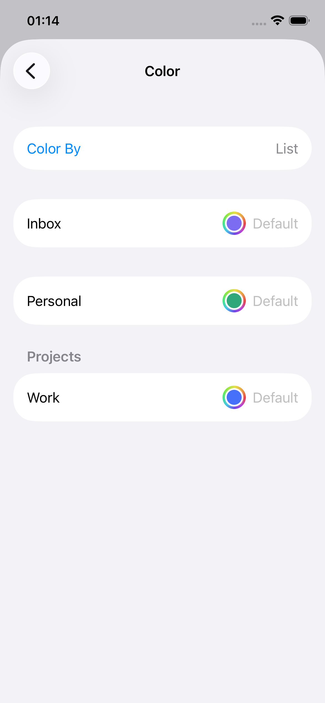](assets/mobile-parity/2026-11-15/c07-calendar-color.png) |
| C08 | Color By menu | Similar | Anchored List/Tag/Priority menu, selected check and actual mode change verified; matched visual acceptance pending. [Receipt](changes/mobile-calendar-color-page-2026-11-16.md) | **Screenshot missing** [Observed reference inventory](ticktick-spec/mobile-surface-inventory-2026-11-14.md) |  |
| C09 | Color Pick/palette | Partial | System picker, not reference named palette families. | **Screenshot missing** [Observed reference inventory](ticktick-spec/mobile-surface-inventory-2026-11-14.md) | **Screenshot missing** Awaiting an inspected capture. |
| C10 | Style | Partial | iPhone Style page carries Modern/Classic preview tiles with shared production policy, a clearly labeled legacy Menu (explicit legacy Buttons on the staged draft, None under Modern/Classic, never coerced), and Hide/Show heatmap tiles; Mac keeps its picker with all four honest choices (no Mac tile redesign). Legacy saved selections preserved with no migration. Native 4/4 passed on the corrected Menu build with inspected neutral tile, Modern/Classic Week, Show/Hide Year, and legacy-Filled screenshots ([tiles](assets/mobile-parity/2026-11-15/c10-style-tiles.png), [Week Modern](assets/mobile-parity/2026-11-15/c10-week-modern.png), [Week Classic](assets/mobile-parity/2026-11-15/c10-week-classic.png), [Year Show](assets/mobile-parity/2026-11-15/c10-year-show.png), [Year Hide](assets/mobile-parity/2026-11-15/c10-year-hide.png), [legacy Filled](assets/mobile-parity/2026-11-15/c10-style-legacy.png)). Exact reference color/border match remains unverified, no pixel-perfect claim. [Receipt](changes/mobile-calendar-style-tiles-2026-11-16.md) | **Screenshot missing** [Observed reference inventory](ticktick-spec/mobile-surface-inventory-2026-11-14.md) |  [PR #115](https://github.com/Mental-NV/Taskovsky/pull/115) · [Capture details](#evidence-c10) Historical QA; not current-main capture. |
| C11 | Show Item Icons | Partial | Task/note/master controls, not full Task/Calendar/Note/Focus inventory. | **Screenshot missing** [Observed reference inventory](ticktick-spec/mobile-surface-inventory-2026-11-14.md) | <a href="assets/mobile-parity/2026-11-15/c11-calendar-icons.png">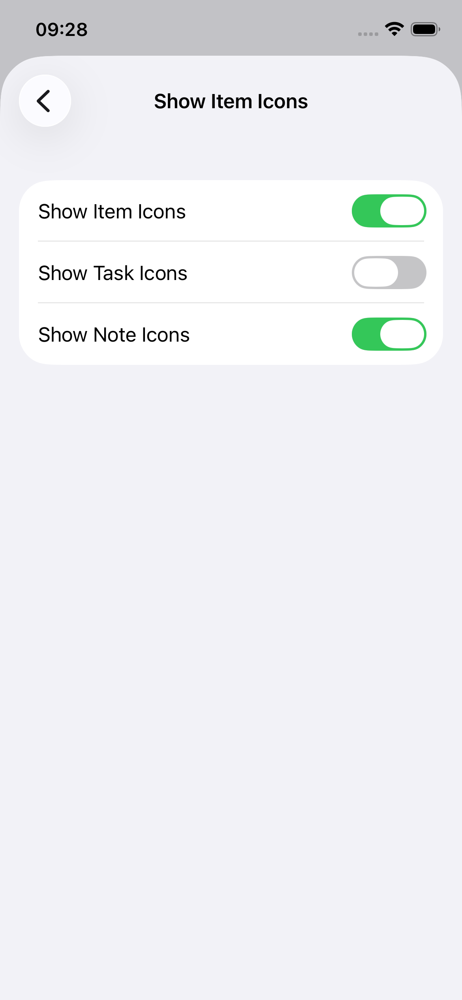</a> [PR #115](https://github.com/Mental-NV/Taskovsky/pull/115) · [Capture details](#evidence-c11) Historical QA; not current-main capture. |
| C12 | Time Zone Settings | Partial | Toggle/current zone/add consolidated; explicit Cancel/Done and header truncation differ from reference. | **Screenshot missing** [Observed reference inventory](ticktick-spec/mobile-surface-inventory-2026-11-14.md) | [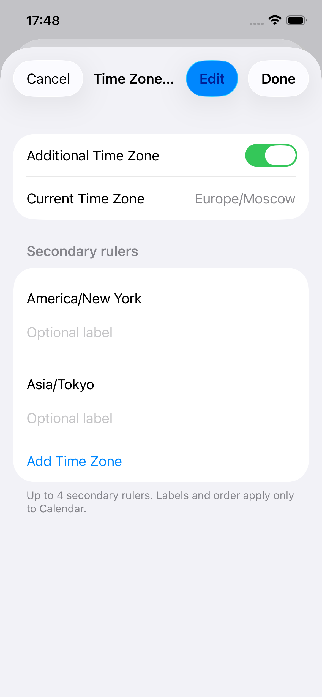](assets/mobile-parity/2026-11-15/c12-time-zone-settings.png) [Receipt](changes/mobile-calendar-zone-settings-2026-11-15.md) |
| C13 | Arrange Tasks panel | Similar | Right panel, grouping, exposed grid and footer implemented; visual tuning remains. | **Screenshot missing** [Observed reference inventory](ticktick-spec/mobile-surface-inventory-2026-11-14.md) | **Screenshot missing** Awaiting an inspected capture. |
| C14 | Arrange overflow | Partial | Undated Task, Overdue Task and Show Notes compose real filters; Show Task Hierarchy ships checked by default and nests List-group candidates with a trailing disclosure (collapse keeps group count; off/on restores the expanded tree; Tag/Priority stay flat). Session-only choices; help truncation and exact reference geometry remain gaps. [Receipt](changes/mobile-arrange-options-2026-11-15.md) · [Hierarchy receipt](changes/mobile-arrange-hierarchy-2026-11-15.md) | **Screenshot missing** [Observed reference inventory](ticktick-spec/mobile-surface-inventory-2026-11-14.md) |  Native checkpoint cec8cf1. 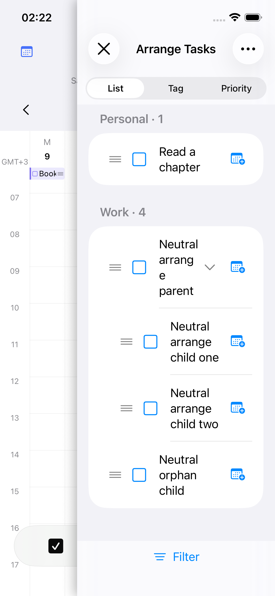  Native 4/4 + drag pass at 3cc4027; pixels inspected, neutral fixture only. |
| C15 | Arrange Filter | Similar | Centered staged multi-source/folders/Cancel/Done; session-only persistence, constraints qualified. | **Screenshot missing** [Observed reference inventory](ticktick-spec/mobile-surface-inventory-2026-11-14.md) | <a href="assets/mobile-parity/2026-11-15/c15-arrange-filter.png">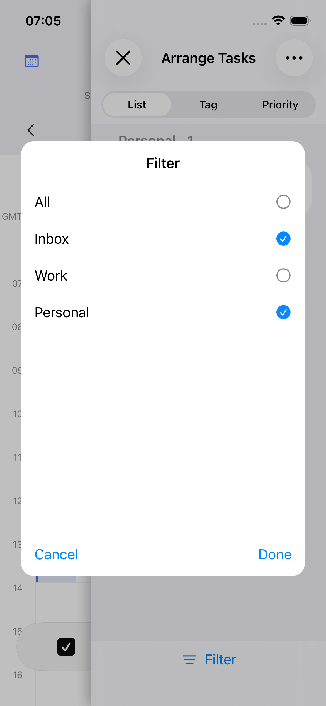</a> [PR #113](https://github.com/Mental-NV/Taskovsky/pull/113) · [Capture details](#evidence-c15) Historical QA; not current-main capture. |

## Task detail and scheduling

| ID | Form / state | General similarity | Biggest remaining gap | TickTick reference | Taskovsky screenshot |
|---|---|---|---|---|---|
| D01 | Task detail | Partial | Empty plain descriptions use one Add description menu; metadata and populated detail layout still differ. | **Screenshot missing** [Observed reference inventory](ticktick-spec/mobile-surface-inventory-2026-11-14.md) |  [PR116](https://github.com/Mental-NV/Taskovsky/pull/116) |
| D02 | Actions sheet | Partial | Supported lifecycle strip on default layouts and real Tags/Add Subtask/Link Parent Task routes; nested sheets return to Task Actions and Share/external actions stay deferred. [Receipt](changes/mobile-detail-actions-2026-11-15.md) | **Screenshot missing** [Observed reference inventory](ticktick-spec/mobile-surface-inventory-2026-11-14.md) | [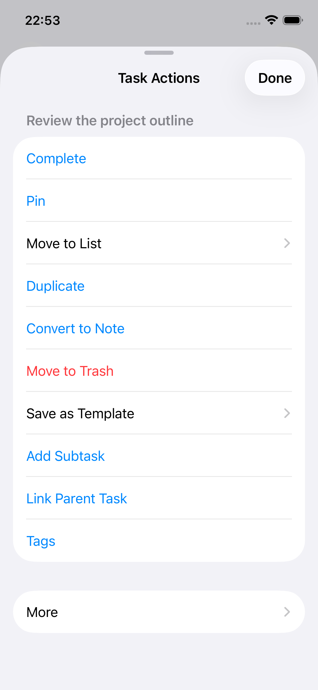](assets/mobile-parity/2026-11-15/d02-task-actions.png) [Receipt](changes/mobile-detail-actions-2026-11-15.md) |
| D03 | Actions More | Partial | Actions/customization counterparts exist; inventory and nested structure differ. | **Screenshot missing** [Observed reference inventory](ticktick-spec/mobile-surface-inventory-2026-11-14.md) | **Screenshot missing** Awaiting an inspected capture. |
| D04 | Tags picker | Partial | Assigned checked section, Input Tag and Close implemented; exact reference save timing and matched layout acceptance remain unverified. | **Screenshot missing** [Observed reference inventory](ticktick-spec/mobile-surface-inventory-2026-11-14.md) |  [Receipt](changes/mobile-assigned-tags-2026-11-15.md) |
| D05 | Priority popup | Partial | Anchored four-choice popup with exact labels/order, current check and real saves; reference timing and calibrated geometry unverified. | **Reference withheld for privacy** |  [Receipt](changes/mobile-detail-priority-popup-2026-11-15.md) |
| D06 | Move to list | Partial | Search, folder hierarchy, current checkmark and Add List implemented; exact layout and reference creation follow-up remain unverified. | **Screenshot missing** [Observed reference inventory](ticktick-spec/mobile-surface-inventory-2026-11-14.md) |  [Receipt](changes/mobile-move-hierarchy-2026-11-15.md) |
| D07 | Schedule Date | Partial | Tabs and month grid implemented; outer and nested presentation still differ. | **Screenshot missing** [Observed reference inventory](ticktick-spec/mobile-surface-inventory-2026-11-14.md) |  [PR #114](https://github.com/Mental-NV/Taskovsky/pull/114) · [Capture details](#evidence-d07) Historical QA; not current-main capture. |
| D08 | Duration | Partial | Timed Date/Time and all-day Start/End cards with true nested Cancel/Done; range moves and existing conversions preserved. Timeline handles/floating policy and final styling remain. [Receipt](changes/mobile-duration-cards-2026-11-16.md). | **Private reference withheld** [Observed reference inventory](ticktick-spec/mobile-surface-inventory-2026-11-14.md) |  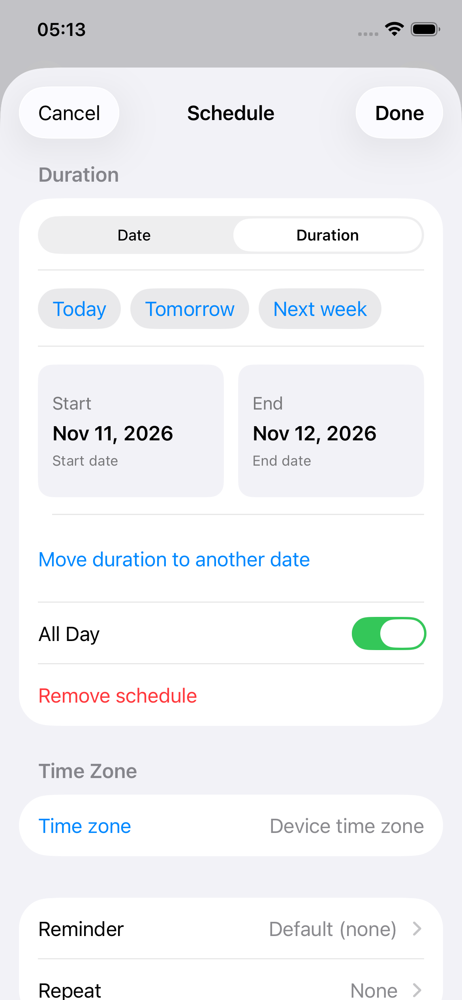 |
| D09 | Time wheel | Partial | Compact wheel popup, zone caption, staged removal and cancellation implemented; exact reference geometry/default time unverified. | **Reference withheld for privacy** |  [Receipt](changes/mobile-time-popup-2026-11-15.md) |
| D10 | Reminder menu | Partial | [Real all-day single-date multi-select09:00 presets and None](changes/mobile-reminder-presets-2026-11-16.md); absolute/default editors retained. Anchored menu placement and timed/duration presets remain open. | **Screenshot missing** [Observed reference inventory](ticktick-spec/mobile-surface-inventory-2026-11-14.md) |  |
| D11 | Custom Reminder | Partial | [All-day single-date Day/Week offset/time wheels](changes/mobile-custom-reminder-2026-11-15.md), staged Add/Cancel and expired validation. Anchored placement, timed/duration extension and reference defaults remain unmatched. | **Screenshot missing** [Observed reference inventory](ticktick-spec/mobile-surface-inventory-2026-11-14.md) |  |
| D12 | Repeat menu | Partial | Simple/custom recurrence exists; labels, presentation and summaries differ. | **Screenshot missing** [Observed reference inventory](ticktick-spec/mobile-surface-inventory-2026-11-14.md) |  [Receipt](changes/mobile-schedule-options-2026-11-15.md) |
| D13 | Custom Repeat | Partial | [Frequency wheels, summary and weekday chips](changes/mobile-repeat-frequency-2026-11-15.md) preserve recurrence logic. Exact interval fallback retains full range; Repeat Type shape and final spacing remain unmatched. | **Screenshot missing** [Observed reference inventory](ticktick-spec/mobile-surface-inventory-2026-11-14.md) |  |
| D14 | Repeat Type | Partial | [Combined three-choice menu](changes/mobile-repeat-type-2026-11-15.md) with exact wording/current check and distinct existing anchor/date behavior. Source transitions and final spacing not certified. | **Screenshot missing** [Observed reference inventory](ticktick-spec/mobile-surface-inventory-2026-11-14.md) | 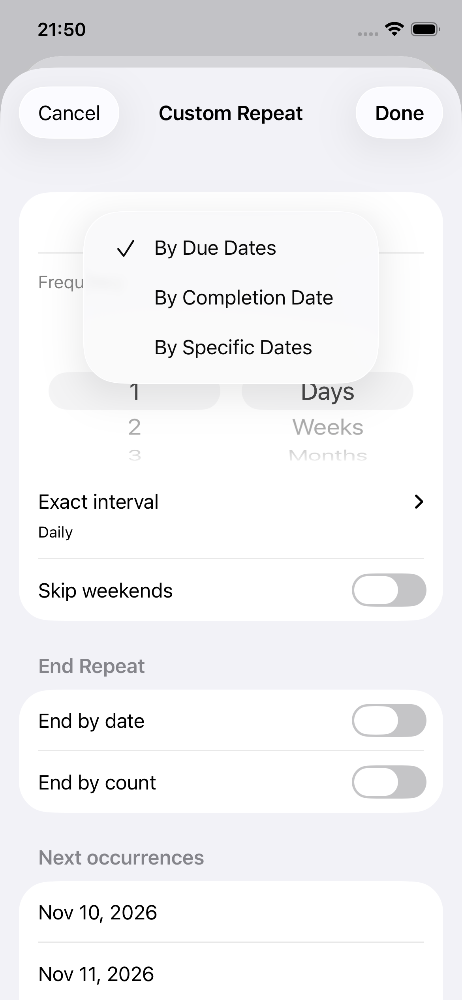 |

## Tasks and organization

| ID | Form / state | General similarity | Biggest remaining gap | TickTick reference | Taskovsky screenshot |
|---|---|---|---|---|---|
| T01 | Today / List | Similar | Grouped compact rows implemented; header, icons and row details remain. | **Screenshot missing** [Observed reference inventory](ticktick-spec/mobile-surface-inventory-2026-11-14.md) | <a href="assets/mobile-parity/2026-11-15/t01-today-list.png">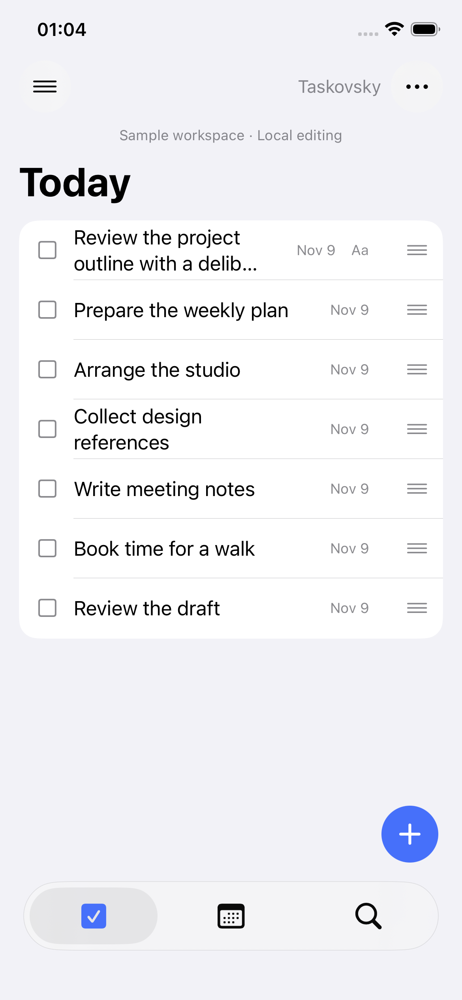</a> [PR #102](https://github.com/Mental-NV/Taskovsky/pull/102) · [Capture details](#evidence-t01) Historical QA; not current-main capture. |
| T02 | Tasks overflow | Partial | Details implemented for ordinary List/Kanban; Completed hide/collapse for ordinary List with scoped batch behavior. Checklist hiding deferred pending evidence; excluded routes and final visual polish remain. [Receipt](changes/mobile-task-display-2026-11-15.md). | **Private reference withheld** [Observed reference inventory](ticktick-spec/mobile-surface-inventory-2026-11-14.md) | 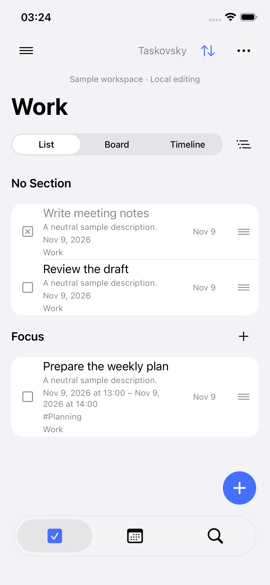 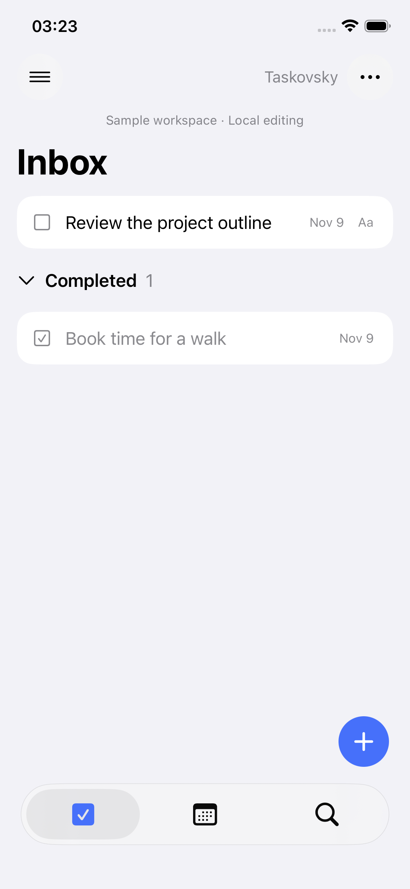 [Kanban details result](assets/mobile-parity/2026-11-15/t02-kanban-details.png). Resulting display states, not overflow screenshot. |
| T03 | List / Kanban submenu | Similar | Both modes exist; scoped Kanban adds Created Time and Tag lanes. Ordinary list status/section boards remain separate; final geometry differs. | **Screenshot missing** [Observed reference inventory](ticktick-spec/mobile-surface-inventory-2026-11-14.md) |  [Receipt](changes/mobile-kanban-group-sort-2026-11-16.md) |
| T04 | Group & Sort | Similar structure; semantics qualified | Scoped Kanban now has the observed 5-group/6-sort pill sheet, immediate selection/direction, backdrop dismissal and real Tag subsections. No invented None/Existing Order/Done. List choices remain separate; exact multi-tag/secondary order and calibrated pixel polish remain open. | **Private reference withheld** [Observed reference inventory](ticktick-spec/mobile-surface-inventory-2026-11-14.md) |  [Before/after and verification](changes/mobile-kanban-sheet-2026-11-16.md) · [List choices](assets/mobile-parity/2026-11-15/t04-complete-choices.png) |
| T05 | Share / Print | Deferred | Explicitly deferred until core features are finished. | **Screenshot missing** [Observed reference inventory](ticktick-spec/mobile-surface-inventory-2026-11-14.md) | **Screenshot missing** Awaiting an inspected capture. |
| T06 | Background chooser | Deferred | Explicitly deferred until core features are finished. | **Screenshot missing** [Observed reference inventory](ticktick-spec/mobile-surface-inventory-2026-11-14.md) | **Screenshot missing** Awaiting an inspected capture. |
| T07 | Tasks drawer | Similar | Indigo navigation implemented; account, utilities and hierarchy differ. | **Screenshot missing** [Observed reference inventory](ticktick-spec/mobile-surface-inventory-2026-11-14.md) | **Screenshot missing** Awaiting an inspected capture. |
| T08 | Drawer Add | Similar | List/filter/tag routes exist; popup options differ. | **Screenshot missing** [Observed reference inventory](ticktick-spec/mobile-surface-inventory-2026-11-14.md) | **Screenshot missing** Awaiting an inspected capture. |
| T09 | Smart Lists management | Partial | Unified Smart Lists/Tags tabs, staged visibility/order and safe nested editors implemented; exact layout/checkmark and unsupported external sources remain. | **Reference withheld for privacy** |  [Receipt](changes/mobile-unified-management-2026-11-16.md) |
| T10 | Smart-list visibility popup | Similar | Show / Show if not empty / Hidden choices exist; visual match pending. | **Screenshot missing** [Observed reference inventory](ticktick-spec/mobile-surface-inventory-2026-11-14.md) | **Screenshot missing** Awaiting an inspected capture. |
| T11 | Management Tags tab | Partial | Tags visibility, Add Tag and existing editable tags share unified staged management. Existing standalone tools retained; layout not pixel-certified. | **Reference withheld for privacy** | [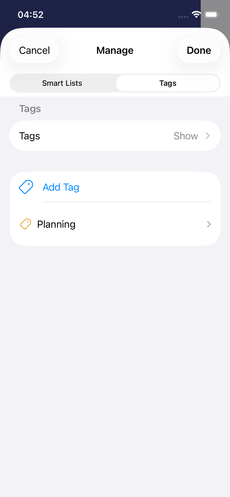](assets/mobile-parity/2026-11-15/t11-unified-tags.png) [Receipt](changes/mobile-unified-management-2026-11-16.md) |
| T12 | Add List | Partial | Real List/Kanban/Timeline creation previews and More implemented; reference palette, advanced wording and final layout remain unverified. | **Screenshot missing** [Observed reference inventory](ticktick-spec/mobile-surface-inventory-2026-11-14.md) | [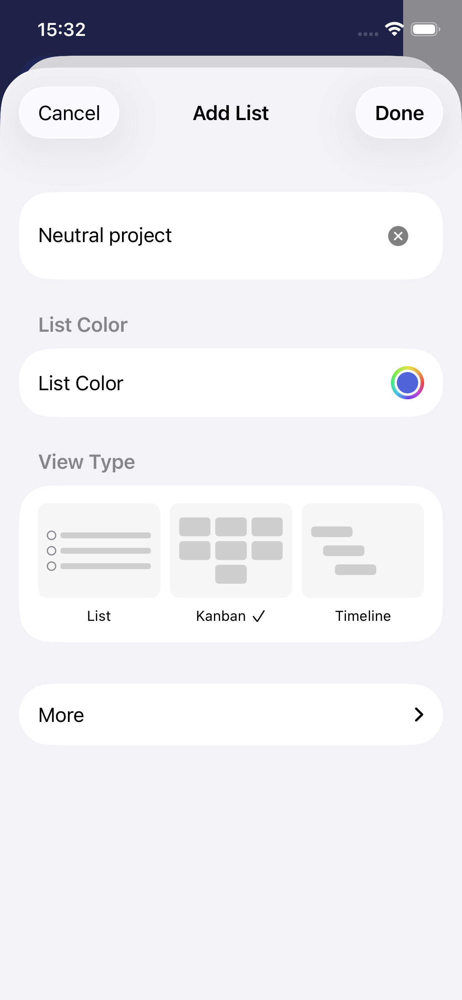](assets/mobile-parity/2026-11-15/t12-list-creation.png) [Receipt](changes/mobile-list-creation-2026-11-15.md) |
| T13 | Normal Filter | Partial | List/Tag/Date/Priority, keyword/type, explicit All resets and real Preview; More preserves Status/tag matching. Native persistence/cancel covered. Exact layout not certified. | **Reference withheld** [Observed reference inventory](ticktick-spec/mobile-surface-inventory-2026-11-14.md) | 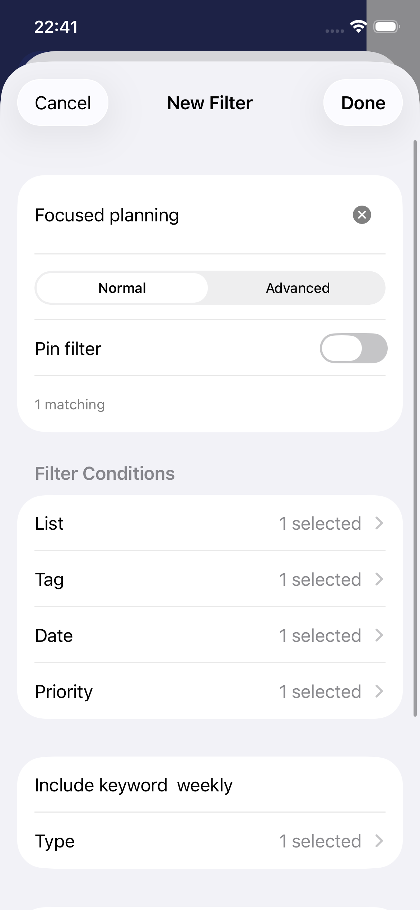  [Verification](changes/mobile-normal-filter-2026-11-15.md) |
| T14 | Advanced Filter | Partial | Filter/Logic labels, existing nested rules, real draft Preview and read-only Taskovsky-authored Examples. Empty root Preview is disabled without changing saved predicate semantics. | **Reference withheld** [Observed reference inventory](ticktick-spec/mobile-surface-inventory-2026-11-14.md) |   [Verification](changes/mobile-advanced-filter-2026-11-15.md) |
| T15 | Add Tag | Partial | Add Tag title/check, blank-name validation, real inline palette/current selection, retained custom color and Parent Tag. Exact reference colors/geometry unverified. | **Reference withheld** [Observed reference inventory](ticktick-spec/mobile-surface-inventory-2026-11-14.md) |   [Verification](changes/mobile-add-tag-2026-11-15.md) |
| T16 | Parent Tag | Partial | Explicit None/radio choices and cycle-safe staged selection implemented; exact geometry/order unverified. | **Screenshot missing** [Reference inventory](ticktick-spec/mobile-surface-inventory-2026-11-14.md) | [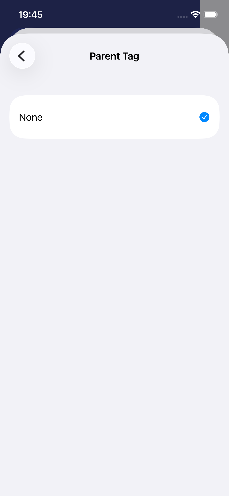](assets/mobile-parity/2026-11-15/t16-parent-tag.png) [Receipt](changes/mobile-parent-tag-2026-11-15.md) |
| T17 | Quick-add composer | Partial | Compact core actions and More→advanced form; keyboard/height and fine layout still differ. | **Screenshot missing** [Observed reference inventory](ticktick-spec/mobile-surface-inventory-2026-11-14.md) |  [Receipt](changes/mobile-compact-capture-2026-11-15.md) |

## Screenshot gallery

Click an image for original resolution. [Machine-readable provenance and SHA-256 manifest](assets/mobile-parity/2026-11-15/manifest.json). Capture runtime metadata is limited to what the linked QA receipt records; no unrecorded device, build or scale is inferred.

### C03: Week overview

Historical [PR #112](https://github.com/Mental-NV/Taskovsky/pull/112) QA capture; [verification receipt](changes/mobile-week-overview-2026-11-15.md). 1170 × 2532 pixels.

### C04: Calendar overflow menu

Historical [PR #103](https://github.com/Mental-NV/Taskovsky/pull/103) QA capture; [verification receipt](changes/mobile-calendar-header-2026-11-14.md). 1170 × 2532 pixels.

### C10: Style

Historical [PR #115](https://github.com/Mental-NV/Taskovsky/pull/115) QA capture; [verification receipt](changes/mobile-calendar-options-navigation-2026-11-15.md). 1170 × 2532 pixels.

### C11: Show Item Icons

Historical [PR #115](https://github.com/Mental-NV/Taskovsky/pull/115) QA capture; [verification receipt](changes/mobile-calendar-options-navigation-2026-11-15.md). 1170 × 2532 pixels.

### C15: Arrange Filter

Historical [PR #113](https://github.com/Mental-NV/Taskovsky/pull/113) QA capture; [verification receipt](changes/mobile-arrange-filter-2026-11-15.md). 1170 × 2532 pixels.

### D07: Schedule Date

Historical [PR #114](https://github.com/Mental-NV/Taskovsky/pull/114) QA capture; [verification receipt](changes/mobile-schedule-tabs-2026-11-15.md). 1170 × 2532 pixels.

### D08: Duration

Historical [PR #114](https://github.com/Mental-NV/Taskovsky/pull/114) QA capture; [verification receipt](changes/mobile-schedule-tabs-2026-11-15.md). 1170 × 2532 pixels.

### T01: Today / List

Historical [PR #102](https://github.com/Mental-NV/Taskovsky/pull/102) QA capture; [verification receipt](changes/mobile-list-row-density-2026-11-14.md). 1170 × 2532 pixels.

### D01: Empty task description

[PR116](https://github.com/Mental-NV/Taskovsky/pull/116) native source checkpoint `68e6b23`; [receipt](changes/mobile-empty-description-2026-11-15.md). 1170 × 2532 pixels, neutral created QA task. Not a matched TickTick capture.

### T17: Compact capture shell without recovery success area

Follow-up source `a8731b6`; [notice-removal receipt](changes/mobile-capture-notice-2026-11-15.md). Prior [PR120](https://github.com/Mental-NV/Taskovsky/pull/120) compact shell remains partial. 1170 × 2532 pixels. Neutral fixture, real software keyboard. Not a matched reference capture or exact low-sheet geometry.

Schedule Reminder/Repeat images show existing controls on dedicated staged pages, not the reference anchored preset menus. Both states remain partial.

### D06 — Move to hierarchy

Source checkpoint `8b6da8b`; actual owned Simulator QA screenshot (1170×2532), neutral move-hierarchy fixture after creating Neutral destination. Five native regressions and full 835 XCTest + 38 Swift Testing passed; release/signature passed. Matched TickTick layout and its Add List follow-up remain unverified. This is not pixel certification.

### D04 — Assigned Tags picker

Source checkpoint `9459da6`; actual owned Simulator QA screenshot (1170×2532), neutral assigned-tags fixture. Two native regression tests passed; full 835 XCTest + 38 Swift Testing, release and signature verification passed. Assigned section structure is implemented; this is not matched TickTick visual acceptance or pixel certification.

### T12 — Add List view previews

Actual 1170×2532 owned Simulator capture at checkpoint `9b8896b`, neutral project name, keyboard dismissed. Focused capture run 48511 passed; production source unchanged from tested creation candidate. List/Kanban/Timeline choices are backed by atomic initial mode creation. Color palette and matched reference layout remain partial, not pixel certification.

### C05 — Calendar source hierarchy

Actual 1170×2532 owned Simulator capture, neutral calendar-filter-hierarchy fixture. Source `77d6801`, integrated checkpoint `024417d`. Expanded Tags and Projects folder show unchanged staged source selection semantics. Exact reference layout/options are not certified; lower bulk row extends below this viewport.

[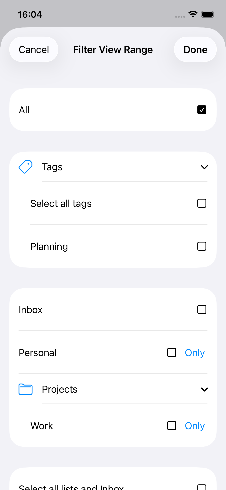](assets/mobile-parity/2026-11-15/c05-source-hierarchy.png)

### C05 — live-observed compact layout follow-up

[Receipt](changes/mobile-calendar-filter-layout-2026-11-15.md). One continuous source surface, 50 pt row pitch, leading gray icons and blue checkmarks reduce the observed PR130 gaps. Cancel, More and long-press Only intentionally preserve Taskovsky capabilities. Approximate reference measurements are not calibrated pixel-perfect certification; no personal TickTick capture is public.

