# Mobile visual parity tracker

Updated: **2026-11-17** (T01 portable reference added; assessments unchanged). Assessment baseline: main `0cbe459` (includes PR115 and scope PR117; plus PR116 empty-description delta). **General similarity, not pixel certification.**

This tracks all **46 original observed states**: 15 Calendar, 14 detail/scheduling, 17 Tasks. **11 broadly similar (10 Similar plus T04's qualified Similar-structure state), 33 partial, 2 explicitly deferred.** None is certified pixel-perfect. T07/T08 keep their Similar assessments with new Taskovsky screenshots and T10 carries its Similar assessment with its new popup screenshot; only coverage counts change. A counterpart existing does not mean its layout or behavior is complete.

## How to read and maintain

- **Similar**: the general purpose and structure are present, with explicit remaining differences. Not “finished.”
- **Partial**: a counterpart exists but a significant layout, navigation or control gap remains.
- **Deferred**: outside current core completion gates by user direction.
- **Screenshot missing** means no inspected publishable asset attached here, not that the feature is absent.
- These are provisional assessments from merged feature receipts/source and the live reference inventory, not a fresh matched audit of every state.
- **Wide-first:** prioritize major missing structures across core forms before fine pixel polishing. Preserve existing accessibility support; accessibility-specific layouts, Dark and persistence polishing are deferred.
- For each completed UI PR, update affected row, remaining gap, PR/receipt and actual screenshot. Record the captured build; do not label an old screenshot as current. Only compare matched fixture, viewport, theme and text size before upgrading visual acceptance.

## Per-form implementation requirement

Follow the [element and behavior contract](changes/mobile-live-parity-plan-2026-11-14.md#per-form-element-and-behavior-contract): inventory every element in each active form, its position/size, exact observed wording, UX and underlying business logic, with evidence and unknowns explicit. Link each bounded element table and verification receipt from its affected state. Broad major similarity across forms comes first, including complete working elements and comparable layout; near-pixel-perfect polishing is the final stage. Existing row assessments are unchanged by this planning update and are not proof that these expanded element checks have been completed. Retain the two explicitly deferred states and all other current scope deferrals.

## Reading the comparison

Each state has adjacent **TickTick reference** and **Taskovsky screenshot** cells. Existing genuine captures render inline at 180 px wide; click for full resolution. Empty cells explicitly name the missing evidence. No reference images or substitute mockups have been invented. The provenance table below retains per-capture source, receipt and limits.

## Evidence coverage and limits

**42/46 states have an attached Taskovsky screenshot; 4/46 await one. 24/46 have portable TickTick reference images attached here; 22/46 still await one.** The attached Taskovsky assets are unmodified, pixel-inspected owned Simulator QA captures with neutral sample content or settings. T07/T08 are new captures from the drawer candidate at source `dcc0d44` and T10 is a new capture at source `5dff850`; C01/C02 images are from the week-header candidate at source `52cd9af`; C06 images are new from the View Options candidate at source `a638aed` (base `5803158`); other captures are earlier feature checkpoints, **not fresh current-main captures**. C04 in particular predates subsequent Calendar layout changes. Native runs are not all green: the drawer-adjacent pin-switch case failed once and passed an isolated rerun (cause not conclusively established), the fold-cutoffs adjacent case fails identically on this branch and the untouched base, and the two PR156 baseline failures stay open — see the C06 and drawer receipts.

The real TickTick images from the original audit remain in its Computer Use trace, not as durable publishable PNGs, except the T01 owner-supplied manual capture published 2026-11-17 ([reference manifest](assets/mobile-parity/2026-11-17/reference/manifest.json)). See the [reference inventory](ticktick-spec/mobile-surface-inventory-2026-11-14.md) for observed hierarchy and trace locators. Do not infer visual equality from a missing reference image. Prior autonomous capture attempts failed (Preview capture timed out; Shift-Cmd-5 showed no toolbar); the owner-supplied manual image does not prove autonomous capture works, and supported-shortcut export investigation continues separately. Future reference attachments require a matched safe fixture and privacy review; no personal task/account screenshots are published here.

The [prioritized implementation plan](changes/mobile-live-parity-plan-2026-11-14.md) remains the work queue. Additional known modes outside the original 46 must be tracked separately rather than silently changing this denominator.

A [live textual audit (local 2026-11-17 / UTC 2026-11-16)](ticktick-spec/mobile-live-audit-2026-11-16.md) records all 46 states with corrected in-repo Taskovsky links and explicit mismatched-state limits (historical Taskovsky images, different fixtures/keyboard/viewport; Add List More unverified). Its [next-gap plan](changes/mobile-reference-next-plan-2026-11-16.md) prioritizes Week geometry, anchored reminder/repeat presentation, Color Pick hierarchy, and matched-keyboard quick-add after an evidence refresh (C13/D03 missing shots; T02/T03 outcome mismatch). Actual portable screenshot refresh is blocked pending privacy-safe export; coverage is now **42/46 Taskovsky and 1/46 portable reference (T01 owner capture only; 45 missing)**.

## Calendar

| ID | Form / state | General similarity | Biggest remaining gap | TickTick reference | Taskovsky screenshot |
|---|---|---|---|---|---|
| C01 | Hourly Week | Partial | Weekday strip now formats in the Calendar zone at midnight boundaries; the capture shows a partially clipped Sunday column and a tall all-day band, and density, overlaps and gestures still need matched comparison — this slice is header timezone formatting, not Week geometry. [Receipt](changes/mobile-week-header-2026-11-16.md) | **Screenshot missing** [Observed reference inventory](ticktick-spec/mobile-surface-inventory-2026-11-14.md) | [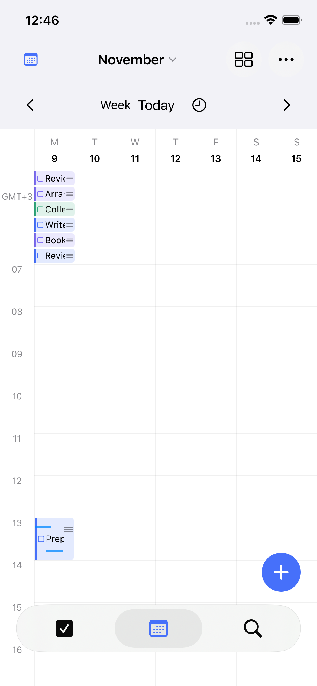](assets/mobile-parity/2026-11-16/c01-week.png) New 2026-11-16 capture at source `52cd9af`; [capture details](#evidence-c01) |
| C02 | Calendar mode menu | Similar | Observed primary order List/Year/Month/Week/3 Day/Day with List naming and separated Multi-Day/Multi-Week extras; single-check, choice/selected-row dismissal and Year relaunch covered — backdrop dismissal and List relaunch persistence not tested. Matched visual acceptance pending. [Receipt](changes/mobile-week-header-2026-11-16.md) | **Screenshot missing** [Observed reference inventory](ticktick-spec/mobile-surface-inventory-2026-11-14.md) | [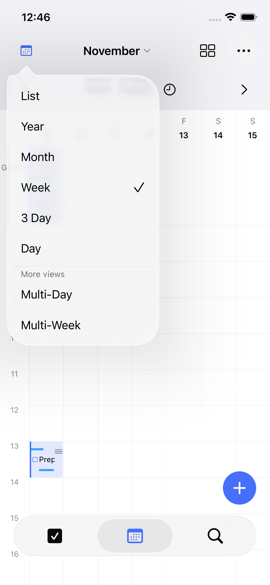](assets/mobile-parity/2026-11-16/c02-mode-menu.png) New 2026-11-16 capture at source `52cd9af`; [capture details](#evidence-c02) |
| C03 | Week overview | Similar | Mini-month, seven tiles and Day/Back implemented; geometry remains approximate. | **Screenshot missing** [Observed reference inventory](ticktick-spec/mobile-surface-inventory-2026-11-14.md) | <a href="assets/mobile-parity/2026-11-15/c03-week-overview.png">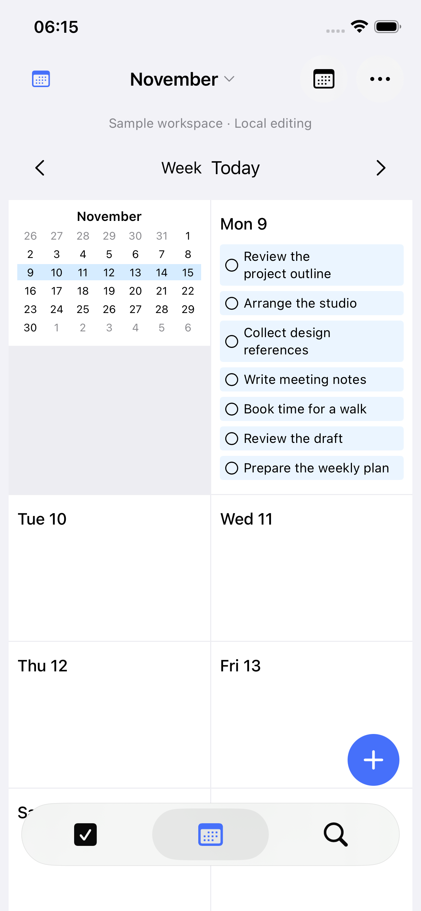</a> [PR #112](https://github.com/Mental-NV/Taskovsky/pull/112) · [Capture details](#evidence-c03) Historical QA; not current-main capture. |
| C04 | Calendar overflow menu | Partial | Core routes exist; subscriptions excluded and Share/Print deferred. | **Screenshot missing** [Observed reference inventory](ticktick-spec/mobile-surface-inventory-2026-11-14.md) |  [PR #103](https://github.com/Mental-NV/Taskovsky/pull/103) · [Capture details](#evidence-c04) Historical QA; not current-main capture. |
| C05 | Filter View Range | Partial | Compact continuous source list aligned to live Mirroring observations; exact typography/colors, non-All reference states and unsupported sources remain unverified. | **Screenshot missing** [Observed reference inventory](ticktick-spec/mobile-surface-inventory-2026-11-14.md) | [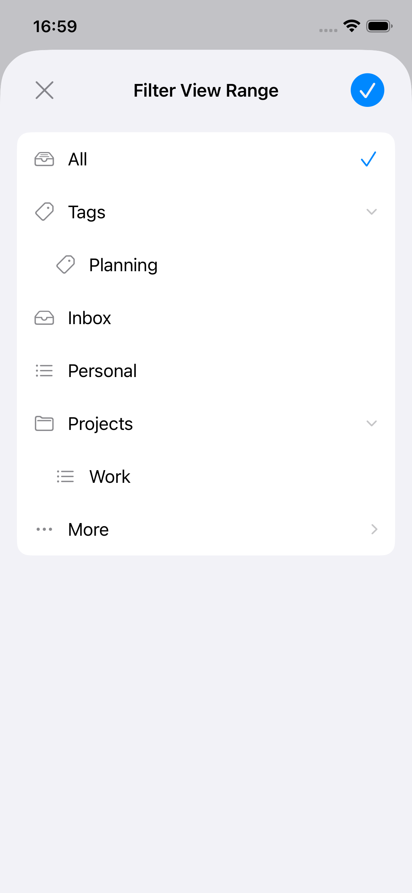](assets/mobile-parity/2026-11-15/c05-compact-layout.png)  Earlier hierarchy capture; [details](#evidence-c05) [Receipt](changes/mobile-calendar-filter-layout-2026-11-15.md) |
| C06 | View Options | Partial | Primary order Color, Style, Show Details, Show Completed, Show Checklist Item (singular), Show All Repeat Cycles, Additional Time Zone; checkmark Done with Done label and retained Cancel; staged save/Cancel across toggles and nested pages; Taskovsky extras (ranges, all-day rows, folded hours) separated below. Declined/focus/health excluded; matched visual acceptance pending. [Receipt](changes/mobile-calendar-view-options-c06-2026-11-16.md) | [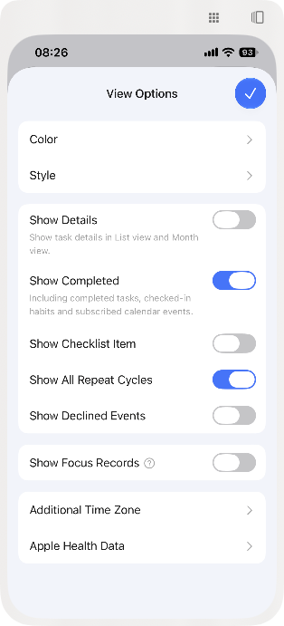](assets/mobile-parity/2026-11-17/reference/c06-ticktick.png) iPhone Mirroring, 2026-11-17. [Observed reference inventory](ticktick-spec/mobile-surface-inventory-2026-11-14.md) | [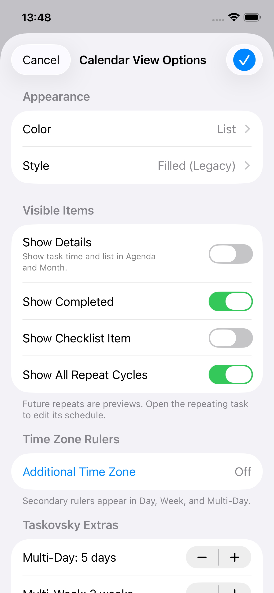](assets/mobile-parity/2026-11-16/c06-view-options-primary.png) [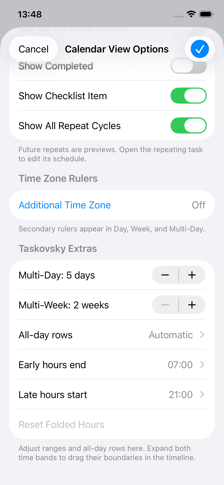](assets/mobile-parity/2026-11-16/c06-view-options-extras.png) New 2026-11-16 capture on this branch; [capture details](#evidence-c06) |
| C07 | Color settings | Partial | Inline Inbox/list/folder swatches, real Calendar-only overrides/reset and staged save/Cancel; named palettes and matched visual acceptance remain. [Receipt](changes/mobile-calendar-color-page-2026-11-16.md) |  iPhone Mirroring, 2026-11-17. [Observed reference inventory](ticktick-spec/mobile-surface-inventory-2026-11-14.md) |  |
| C08 | Color By menu | Similar | Anchored List/Tag/Priority menu, selected check and actual mode change verified; matched visual acceptance pending. [Receipt](changes/mobile-calendar-color-page-2026-11-16.md) | [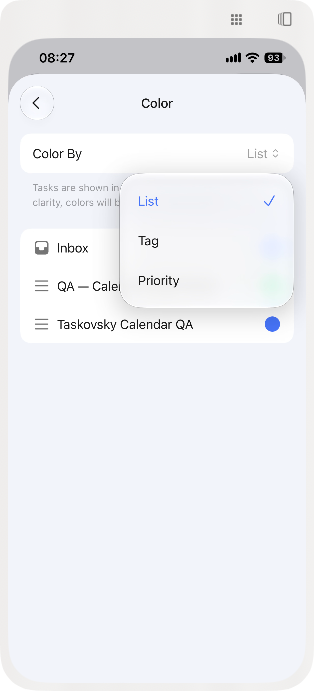](assets/mobile-parity/2026-11-17/reference/c08-ticktick.png) iPhone Mirroring, 2026-11-17. [Observed reference inventory](ticktick-spec/mobile-surface-inventory-2026-11-14.md) | [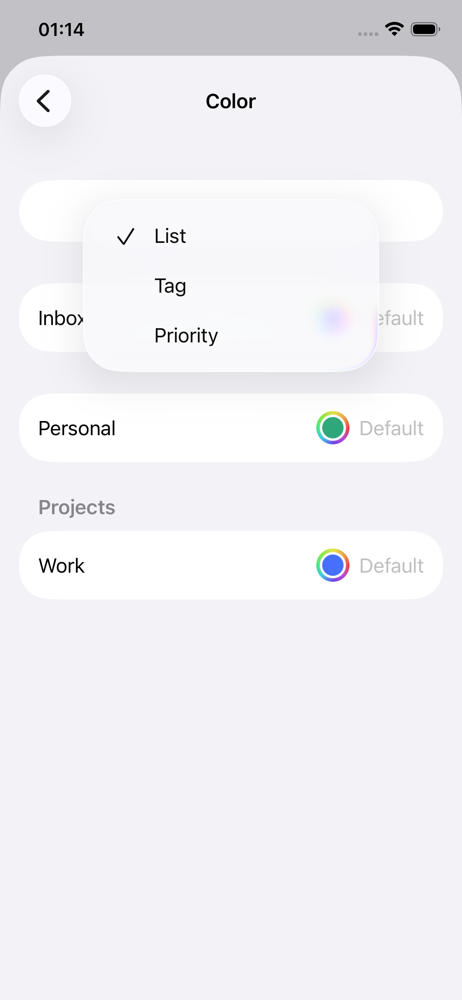](assets/mobile-parity/2026-11-15/c08-color-by.png) |
| C09 | Color Pick/palette | Partial | Pushed Color Pick with honest Taskovsky palette (Default slash, selected ring, Custom native editor); staged Back/Cancel/Done, no record mutation. Named reference families explicitly not reproduced. Native 3/3 passed on the owned Simulator with inspected captures. [Receipt](changes/mobile-calendar-color-pick-2026-11-16.md) | **Screenshot missing** [Observed reference inventory](ticktick-spec/mobile-surface-inventory-2026-11-14.md) | [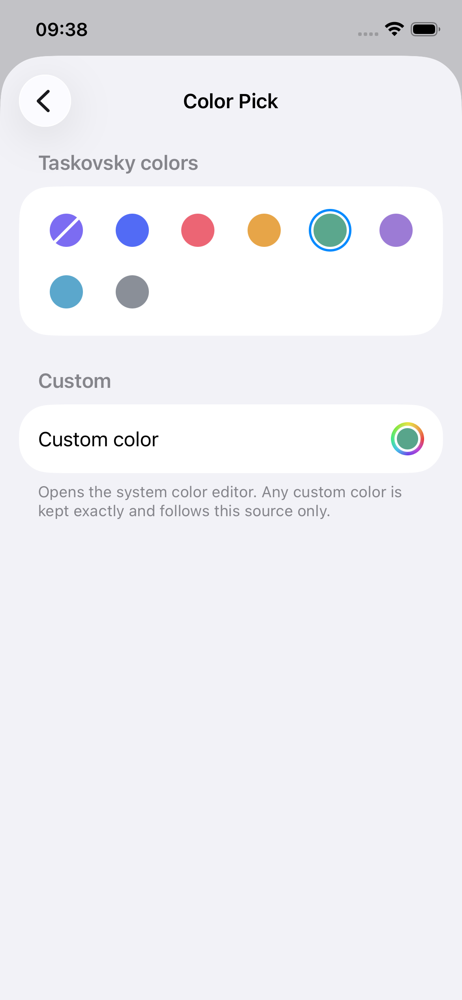](assets/mobile-parity/2026-11-16/c09-color-pick-palette.png) [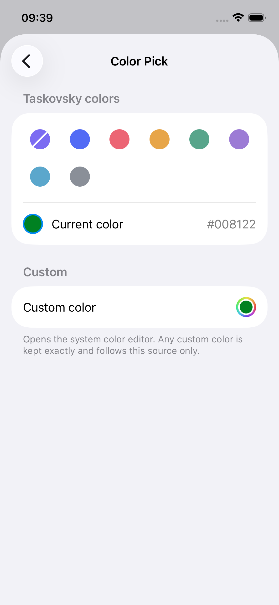](assets/mobile-parity/2026-11-16/c09-current-custom.png) [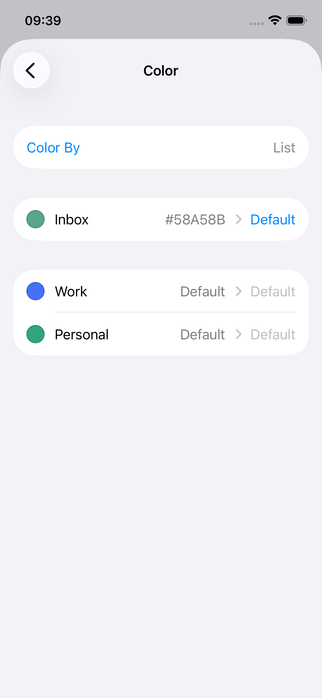](assets/mobile-parity/2026-11-16/c09-color-summary.png) New 2026-11-16 capture on this branch; C07/C08 keep their prior checkpoint images. |
| C10 | Style | Partial | iPhone Style page carries Modern/Classic preview tiles with shared production policy, a clearly labeled legacy Menu (explicit legacy Buttons on the staged draft, None under Modern/Classic, never coerced), and Hide/Show heatmap tiles; Mac keeps its picker with all four honest choices (no Mac tile redesign). Legacy saved selections preserved with no migration. Native 4/4 passed on the corrected Menu build with inspected neutral tile, Modern/Classic Week, Show/Hide Year, and legacy-Filled screenshots ([tiles](assets/mobile-parity/2026-11-15/c10-style-tiles.png), [Week Modern](assets/mobile-parity/2026-11-15/c10-week-modern.png), [Week Classic](assets/mobile-parity/2026-11-15/c10-week-classic.png), [Year Show](assets/mobile-parity/2026-11-15/c10-year-show.png), [Year Hide](assets/mobile-parity/2026-11-15/c10-year-hide.png), [legacy Filled](assets/mobile-parity/2026-11-15/c10-style-legacy.png)). Exact reference color/border match remains unverified, no pixel-perfect claim. [Receipt](changes/mobile-calendar-style-tiles-2026-11-16.md) | **Screenshot missing** [Observed reference inventory](ticktick-spec/mobile-surface-inventory-2026-11-14.md) |  [PR #115](https://github.com/Mental-NV/Taskovsky/pull/115) · [Capture details](#evidence-c10) Historical QA; not current-main capture. |
| C11 | Show Item Icons | Partial | Task/note/master controls, not full Task/Calendar/Note/Focus inventory. | **Screenshot missing** [Observed reference inventory](ticktick-spec/mobile-surface-inventory-2026-11-14.md) |  [PR #115](https://github.com/Mental-NV/Taskovsky/pull/115) · [Capture details](#evidence-c11) Historical QA; not current-main capture. |
| C12 | Time Zone Settings | Partial | Toggle/current zone/add consolidated; explicit Cancel/Done and header truncation differ from reference. | **Screenshot missing** [Observed reference inventory](ticktick-spec/mobile-surface-inventory-2026-11-14.md) |  [Receipt](changes/mobile-calendar-zone-settings-2026-11-15.md) |
| C13 | Arrange Tasks panel | Similar | Right panel, grouping, exposed grid and footer implemented; visual tuning remains. | **Screenshot missing** [Observed reference inventory](ticktick-spec/mobile-surface-inventory-2026-11-14.md) | **Screenshot missing** Awaiting an inspected capture. |
| C14 | Arrange overflow | Partial | Undated Task, Overdue Task and Show Notes compose real filters; Show Task Hierarchy ships checked by default and nests List-group candidates with a trailing disclosure (collapse keeps group count; off/on restores the expanded tree; Tag/Priority stay flat). Session-only choices; help truncation and exact reference geometry remain gaps. [Receipt](changes/mobile-arrange-options-2026-11-15.md) · [Hierarchy receipt](changes/mobile-arrange-hierarchy-2026-11-15.md) | **Screenshot missing** [Observed reference inventory](ticktick-spec/mobile-surface-inventory-2026-11-14.md) | 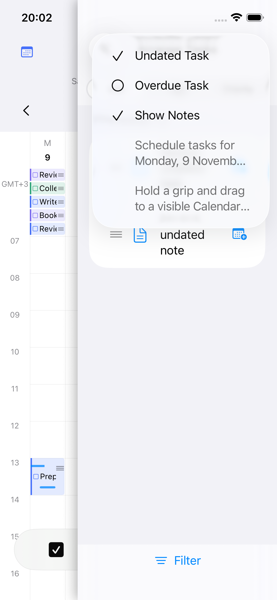 Native checkpoint cec8cf1.  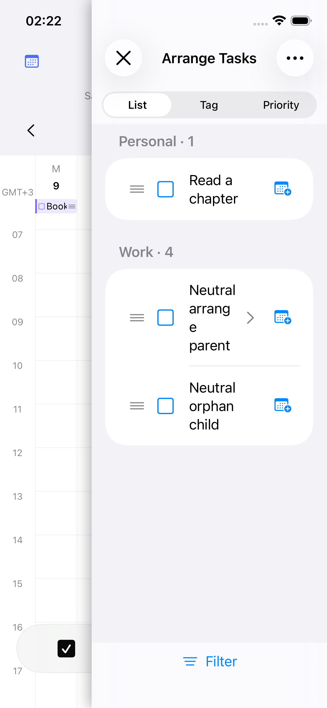 Native 4/4 + drag pass at 3cc4027; pixels inspected, neutral fixture only. |
| C15 | Arrange Filter | Similar | Centered staged multi-source/folders/Cancel/Done; session-only persistence, constraints qualified. | **Screenshot missing** [Observed reference inventory](ticktick-spec/mobile-surface-inventory-2026-11-14.md) |  [PR #113](https://github.com/Mental-NV/Taskovsky/pull/113) · [Capture details](#evidence-c15) Historical QA; not current-main capture. |

## Task detail and scheduling

| ID | Form / state | General similarity | Biggest remaining gap | TickTick reference | Taskovsky screenshot |
|---|---|---|---|---|---|
| D01 | Task detail | Partial | Empty plain descriptions use one Add description menu; metadata and populated detail layout still differ. | [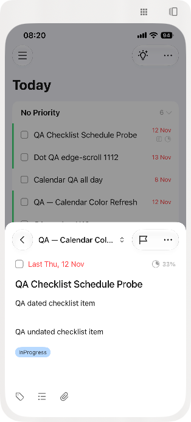](assets/mobile-parity/2026-11-17/reference/d01-ticktick.png) iPhone Mirroring, 2026-11-17. [Observed reference inventory](ticktick-spec/mobile-surface-inventory-2026-11-14.md) |  [PR116](https://github.com/Mental-NV/Taskovsky/pull/116) |
| D02 | Actions sheet | Partial | Supported lifecycle strip on default layouts and real Tags/Add Subtask/Link Parent Task routes; nested sheets return to Task Actions and Share/external actions stay deferred. [Receipt](changes/mobile-detail-actions-2026-11-15.md) | [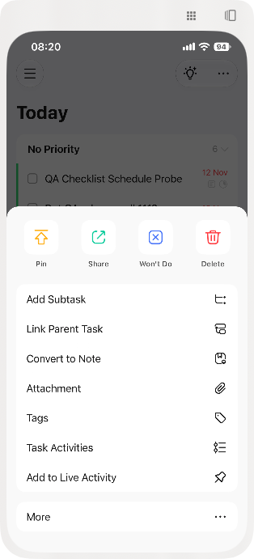](assets/mobile-parity/2026-11-17/reference/d02-ticktick.png) iPhone Mirroring, 2026-11-17. [Observed reference inventory](ticktick-spec/mobile-surface-inventory-2026-11-14.md) |  [Receipt](changes/mobile-detail-actions-2026-11-15.md) |
| D03 | Actions More | Partial | Actions/customization counterparts exist; inventory and nested structure differ. | [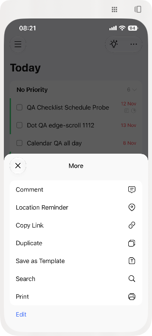](assets/mobile-parity/2026-11-17/reference/d03-ticktick.png) iPhone Mirroring, 2026-11-17. [Observed reference inventory](ticktick-spec/mobile-surface-inventory-2026-11-14.md) | **Screenshot missing** Awaiting an inspected capture. |
| D04 | Tags picker | Partial | Assigned checked section, Input Tag and Close implemented; exact reference save timing and matched layout acceptance remain unverified. | [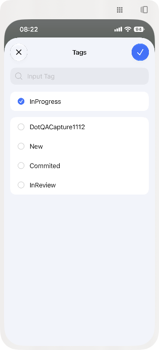](assets/mobile-parity/2026-11-17/reference/d04-ticktick.png) iPhone Mirroring, 2026-11-17. [Observed reference inventory](ticktick-spec/mobile-surface-inventory-2026-11-14.md) |  [Receipt](changes/mobile-assigned-tags-2026-11-15.md) |
| D05 | Priority popup | Partial | Anchored four-choice popup with exact labels/order, current check and real saves; reference timing and calibrated geometry unverified. | [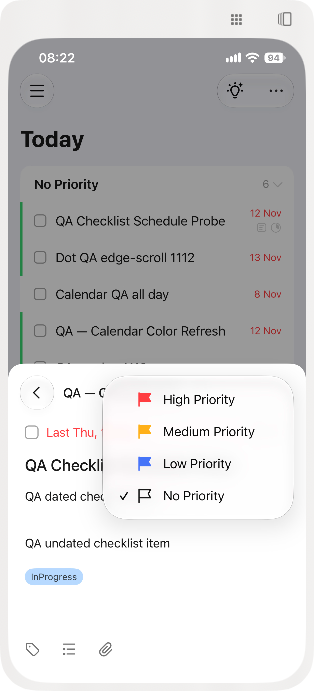](assets/mobile-parity/2026-11-17/reference/d05-ticktick.png) iPhone Mirroring, 2026-11-17. [Observed reference inventory](ticktick-spec/mobile-surface-inventory-2026-11-14.md) | [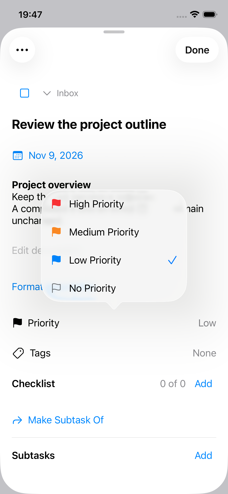](assets/mobile-parity/2026-11-15/d05-priority-popup.png) [Receipt](changes/mobile-detail-priority-popup-2026-11-15.md) |
| D06 | Move to list | Partial | Search, folder hierarchy, current checkmark and Add List implemented; exact layout and reference creation follow-up remain unverified. | [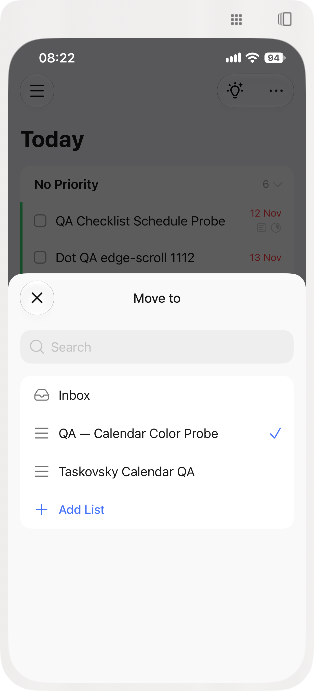](assets/mobile-parity/2026-11-17/reference/d06-ticktick.png) iPhone Mirroring, 2026-11-17. [Observed reference inventory](ticktick-spec/mobile-surface-inventory-2026-11-14.md) | [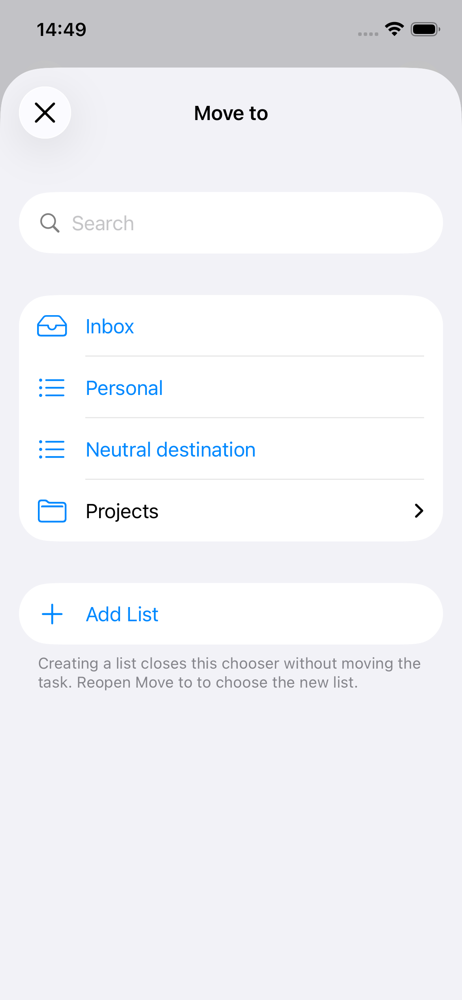](assets/mobile-parity/2026-11-15/d06-move-hierarchy.png) [Receipt](changes/mobile-move-hierarchy-2026-11-15.md) |
| D07 | Schedule Date | Partial | Tabs and month grid implemented; outer and nested presentation still differ. | [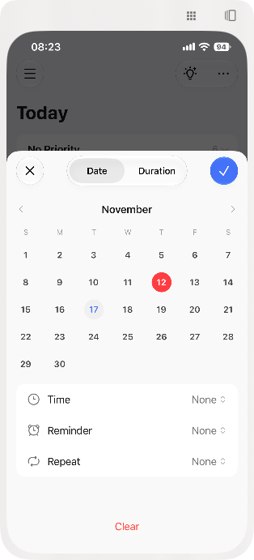](assets/mobile-parity/2026-11-17/reference/d07-ticktick.png) iPhone Mirroring, 2026-11-17. [Observed reference inventory](ticktick-spec/mobile-surface-inventory-2026-11-14.md) |  [PR #114](https://github.com/Mental-NV/Taskovsky/pull/114) · [Capture details](#evidence-d07) Historical QA; not current-main capture. |
| D08 | Duration | Partial | Timed Date/Time and all-day Start/End cards with true nested Cancel/Done; range moves and existing conversions preserved. Timeline handles/floating policy and final styling remain. [Receipt](changes/mobile-duration-cards-2026-11-16.md). | [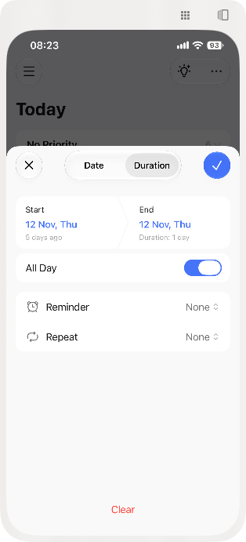](assets/mobile-parity/2026-11-17/reference/d08-ticktick.png) iPhone Mirroring, 2026-11-17. [Observed reference inventory](ticktick-spec/mobile-surface-inventory-2026-11-14.md) | 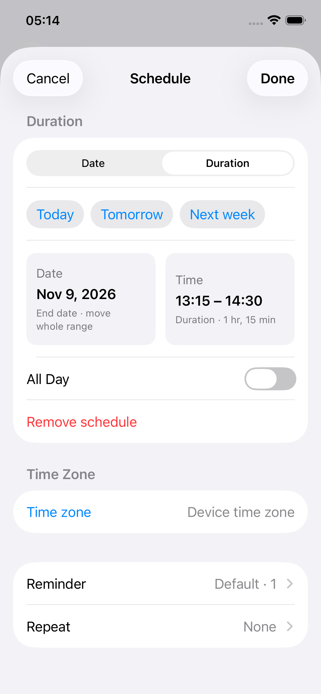  [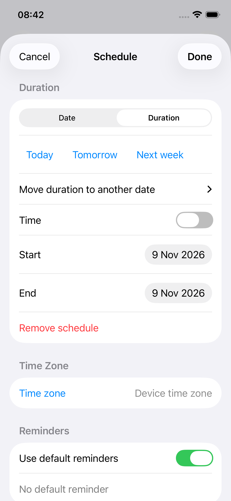](assets/mobile-parity/2026-11-15/d08-schedule-duration.png) Historical PR #114 capture; [details](#evidence-d08) |
| D09 | Time wheel | Partial | Compact wheel popup, zone caption, staged removal and cancellation implemented; exact reference geometry/default time unverified. | **Reference withheld for privacy** | [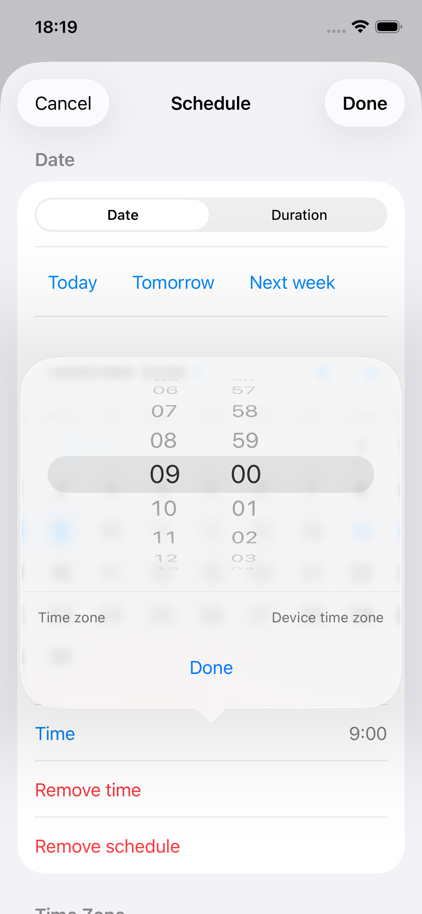](assets/mobile-parity/2026-11-15/d09-time-popup.png) [Receipt](changes/mobile-time-popup-2026-11-15.md) |
| D10 | Reminder menu | Partial | [Real all-day single-date multi-select09:00 presets and None](changes/mobile-reminder-presets-2026-11-16.md); absolute/default editors retained. Anchored menu placement and timed/duration presets remain open. | [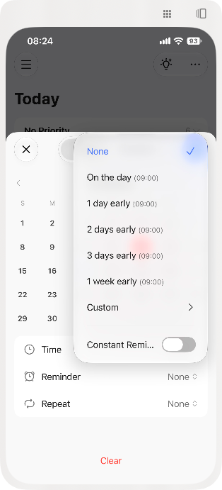](assets/mobile-parity/2026-11-17/reference/d10-ticktick.png) iPhone Mirroring, 2026-11-17. [Observed reference inventory](ticktick-spec/mobile-surface-inventory-2026-11-14.md) | 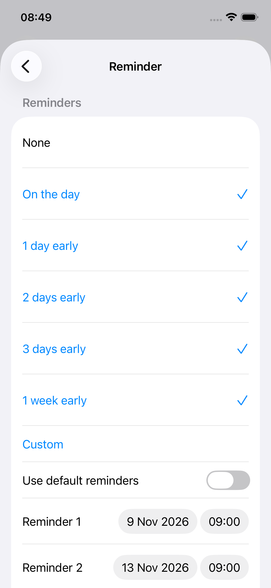 |
| D11 | Custom Reminder | Partial | [All-day single-date Day/Week offset/time wheels](changes/mobile-custom-reminder-2026-11-15.md), staged Add/Cancel and expired validation. Anchored placement, timed/duration extension and reference defaults remain unmatched. | [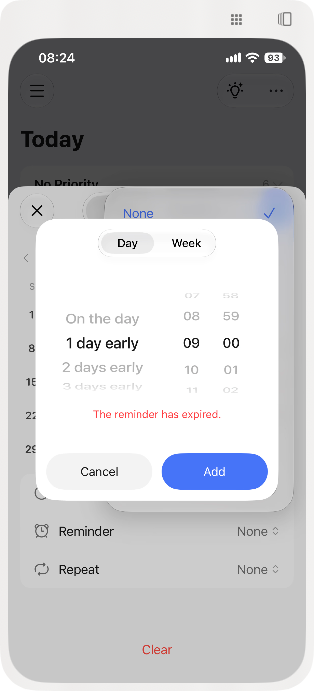](assets/mobile-parity/2026-11-17/reference/d11-ticktick.png) iPhone Mirroring, 2026-11-17. [Observed reference inventory](ticktick-spec/mobile-surface-inventory-2026-11-14.md) | 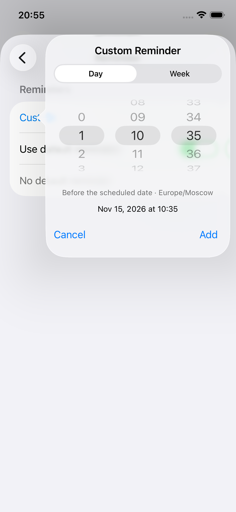 |
| D12 | Repeat menu | Partial | Reference-ordered preset menu with live-derived labels, current check, tap-to-stage-and-return and direct Custom route implemented; pushed page retained, anchored placement, grid highlight and Repeat Ends root row remain open. [Receipt](changes/mobile-repeat-menu-2026-11-16.md) | [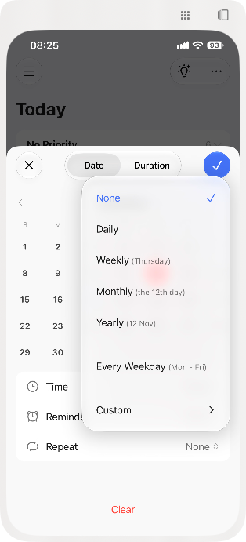](assets/mobile-parity/2026-11-17/reference/d12-ticktick.png) iPhone Mirroring, 2026-11-17. [Observed reference inventory](ticktick-spec/mobile-surface-inventory-2026-11-14.md) | [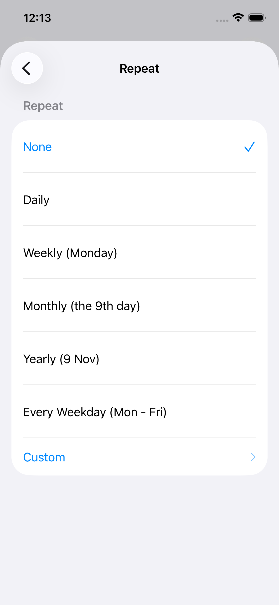](assets/mobile-parity/2026-11-16/d12-repeat-presets.png) Final Run 3 neutral capture; pushed-page structure, not anchored-menu parity. |
| D13 | Custom Repeat | Partial | [Frequency wheels, summary and weekday chips](changes/mobile-repeat-frequency-2026-11-15.md) preserve recurrence logic. Exact interval fallback retains full range; Repeat Type shape and final spacing remain unmatched. | [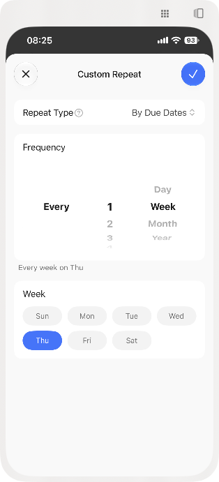](assets/mobile-parity/2026-11-17/reference/d13-ticktick.png) iPhone Mirroring, 2026-11-17. [Observed reference inventory](ticktick-spec/mobile-surface-inventory-2026-11-14.md) | 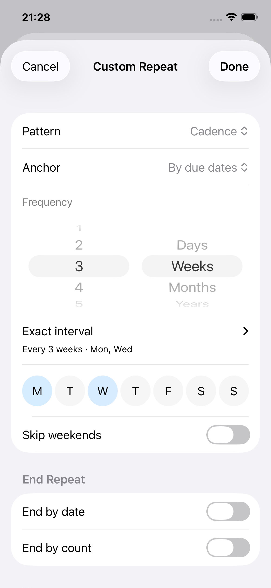 |
| D14 | Repeat Type | Partial | [Combined three-choice menu](changes/mobile-repeat-type-2026-11-15.md) with exact wording/current check and distinct existing anchor/date behavior. Source transitions and final spacing not certified. | [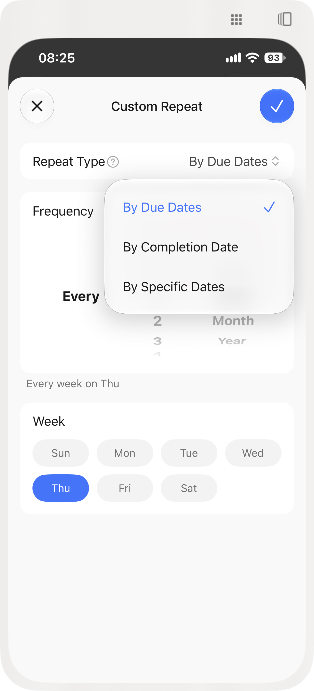](assets/mobile-parity/2026-11-17/reference/d14-ticktick.png) iPhone Mirroring, 2026-11-17. [Observed reference inventory](ticktick-spec/mobile-surface-inventory-2026-11-14.md) |  |

## Tasks and organization

| ID | Form / state | General similarity | Biggest remaining gap | TickTick reference | Taskovsky screenshot |
|---|---|---|---|---|---|
| T01 | Today / List | Similar | Grouped compact rows implemented; header, icons and row details remain. | [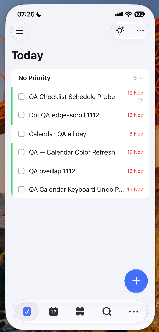](assets/mobile-parity/2026-11-17/reference/t01-ticktick-owner.png) Owner-supplied manual window capture, 2026-11-17; light appearance; device/scale unknown; no pixel certification. [Observed reference inventory](ticktick-spec/mobile-surface-inventory-2026-11-14.md) |  [PR #102](https://github.com/Mental-NV/Taskovsky/pull/102) · [Capture details](#evidence-t01) Historical QA; not current-main capture. |
| T02 | Tasks overflow | Partial | Details implemented for ordinary List/Kanban; Completed hide/collapse for ordinary List with scoped batch behavior. Checklist hiding deferred pending evidence; excluded routes and final visual polish remain. [Receipt](changes/mobile-task-display-2026-11-15.md). | [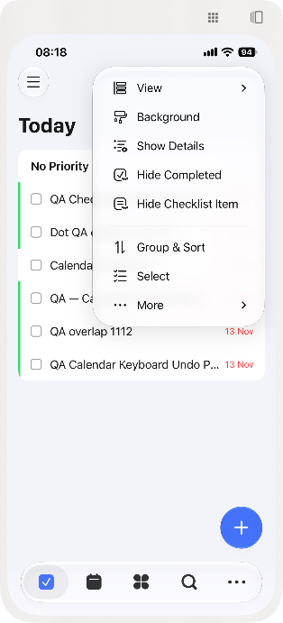](assets/mobile-parity/2026-11-17/reference/t02-ticktick.png) iPhone Mirroring, 2026-11-17. [Observed reference inventory](ticktick-spec/mobile-surface-inventory-2026-11-14.md) |   [Kanban details result](assets/mobile-parity/2026-11-15/t02-kanban-details.png). Resulting display states, not overflow screenshot. |
| T03 | List / Kanban submenu | Similar | Both modes exist; scoped Kanban adds Created Time and Tag lanes. Ordinary list status/section boards remain separate; final geometry differs. | [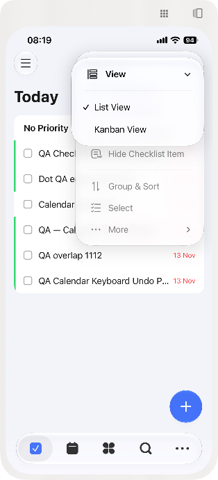](assets/mobile-parity/2026-11-17/reference/t03-ticktick.png) iPhone Mirroring, 2026-11-17. [Observed reference inventory](ticktick-spec/mobile-surface-inventory-2026-11-14.md) | [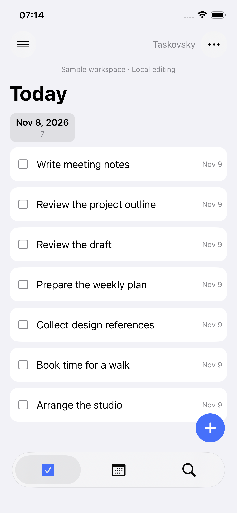](assets/mobile-parity/2026-11-16/t03-kanban-created-time.png) [Receipt](changes/mobile-kanban-group-sort-2026-11-16.md) |
| T04 | Group & Sort | Similar structure; semantics qualified | Scoped Kanban now has the observed 5-group/6-sort pill sheet, immediate selection/direction, backdrop dismissal and real Tag subsections. No invented None/Existing Order/Done. List choices remain separate; exact multi-tag/secondary order and calibrated pixel polish remain open. | [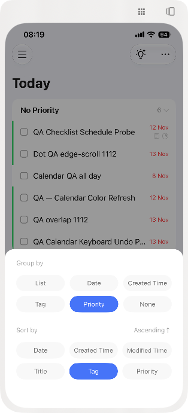](assets/mobile-parity/2026-11-17/reference/t04-ticktick.png) iPhone Mirroring, 2026-11-17. [Observed reference inventory](ticktick-spec/mobile-surface-inventory-2026-11-14.md) | [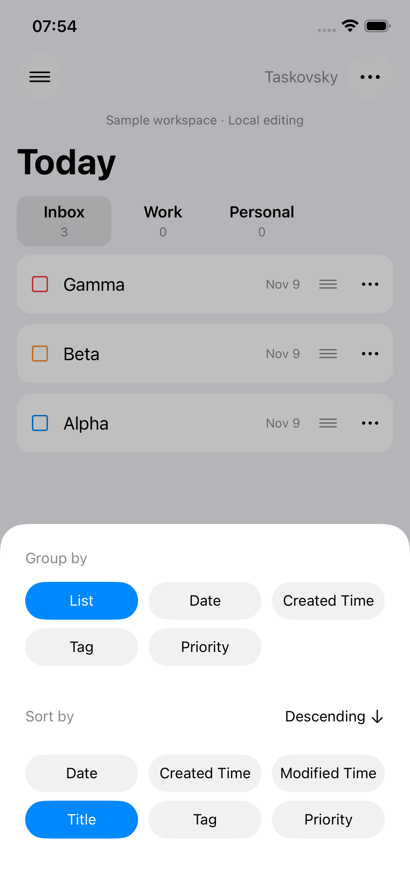](assets/mobile-parity/2026-11-16/t04-kanban-sheet.png) [Before/after and verification](changes/mobile-kanban-sheet-2026-11-16.md) · [List choices](assets/mobile-parity/2026-11-15/t04-complete-choices.png) |
| T05 | Share / Print | Deferred | Explicitly deferred until core features are finished. | [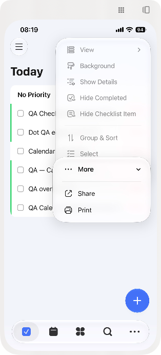](assets/mobile-parity/2026-11-17/reference/t05-ticktick.png) iPhone Mirroring, 2026-11-17. [Observed reference inventory](ticktick-spec/mobile-surface-inventory-2026-11-14.md) | **Screenshot missing** Awaiting an inspected capture. |
| T06 | Background chooser | Deferred | Explicitly deferred until core features are finished. |  iPhone Mirroring, 2026-11-17. [Observed reference inventory](ticktick-spec/mobile-surface-inventory-2026-11-14.md) | **Screenshot missing** Awaiting an inspected capture. |
| T07 | Tasks drawer | Similar | Bottom-anchored Add and unified-management footer implemented; account/utility placement and hierarchy differ, matched visual acceptance pending. [Receipt](changes/mobile-drawer-add-2026-11-16.md) | **Screenshot missing** [Observed reference inventory](ticktick-spec/mobile-surface-inventory-2026-11-14.md) | [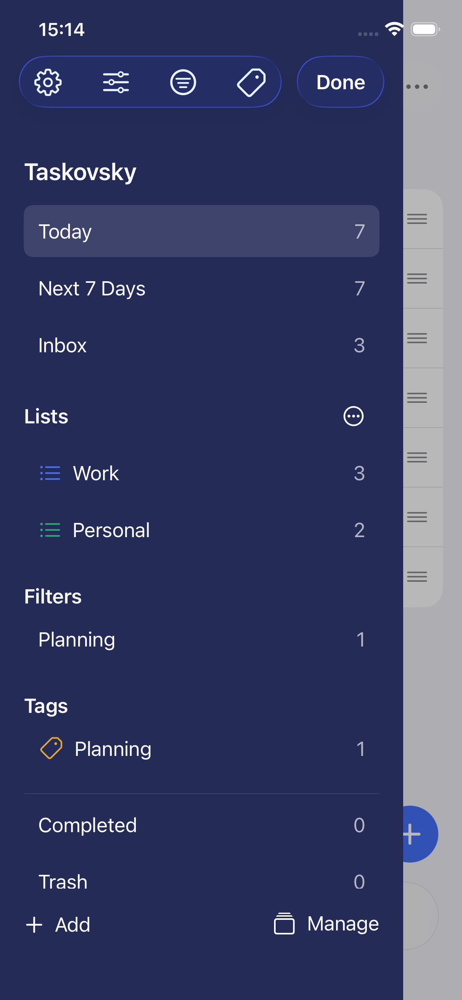](assets/mobile-parity/2026-11-16/t07-drawer-footer.png) New 2026-11-16 capture on this branch; [capture details](#evidence-t07) |
| T08 | Drawer Add | Similar | Anchored List/Filter/Tag popup in exact reference order with direct blank routes implemented; matched visual acceptance pending. [Receipt](changes/mobile-drawer-add-2026-11-16.md) | **Screenshot missing** [Observed reference inventory](ticktick-spec/mobile-surface-inventory-2026-11-14.md) | [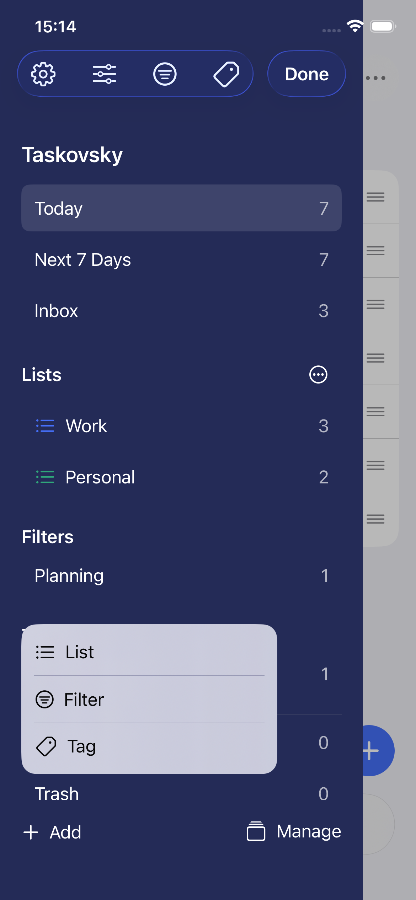](assets/mobile-parity/2026-11-16/t08-add-popup.png) New 2026-11-16 capture on this branch; [capture details](#evidence-t08) |
| T09 | Smart Lists management | Partial | Unified Smart Lists/Tags tabs, staged visibility/order and safe nested editors implemented; exact layout/checkmark and unsupported external sources remain. | **Reference withheld for privacy** | [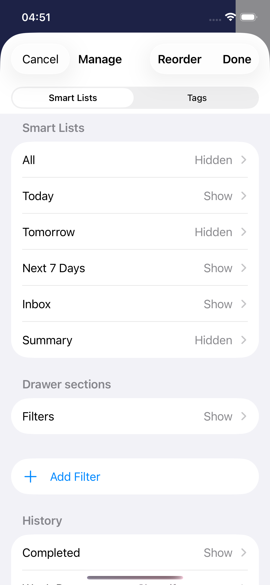](assets/mobile-parity/2026-11-15/t09-unified-smartlists.png) [Receipt](changes/mobile-unified-management-2026-11-16.md) |
| T10 | Smart-list visibility popup | Similar | Anchored Show / Show if not empty / Hidden, current check and staged Cancel/Done/backdrop flows implemented; exact geometry, large-text fit and VoiceOver remain unverified. [Receipt](changes/mobile-visibility-popup-2026-11-16.md) | **Screenshot missing** [Observed reference inventory](ticktick-spec/mobile-surface-inventory-2026-11-14.md) | [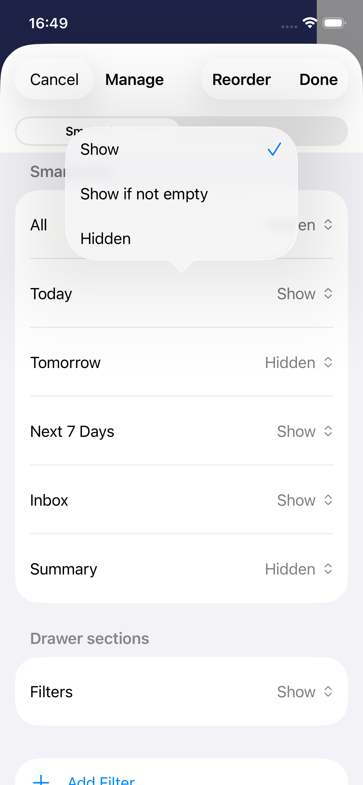](assets/mobile-parity/2026-11-16/t10-visibility-popup.png) Source `5dff850`; neutral owned Simulator capture, pixels inspected. |
| T11 | Management Tags tab | Partial | Tags visibility, Add Tag and existing editable tags share unified staged management. Existing standalone tools retained; layout not pixel-certified. | **Reference withheld for privacy** |  [Receipt](changes/mobile-unified-management-2026-11-16.md) |
| T12 | Add List | Partial | Real List/Kanban/Timeline creation previews and More implemented; reference palette, advanced wording and final layout remain unverified. | [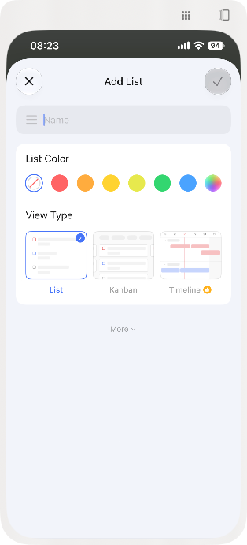](assets/mobile-parity/2026-11-17/reference/t12-ticktick.png) iPhone Mirroring, 2026-11-17. [Observed reference inventory](ticktick-spec/mobile-surface-inventory-2026-11-14.md) |  [Receipt](changes/mobile-list-creation-2026-11-15.md) |
| T13 | Normal Filter | Partial | List/Tag/Date/Priority, keyword/type, explicit All resets and real Preview; More preserves Status/tag matching. Native persistence/cancel covered. Exact layout not certified. | **Reference withheld** [Observed reference inventory](ticktick-spec/mobile-surface-inventory-2026-11-14.md) |   [Verification](changes/mobile-normal-filter-2026-11-15.md) |
| T14 | Advanced Filter | Partial | Filter/Logic labels, existing nested rules, real draft Preview and read-only Taskovsky-authored Examples. Empty root Preview is disabled without changing saved predicate semantics. | **Reference withheld** [Observed reference inventory](ticktick-spec/mobile-surface-inventory-2026-11-14.md) | 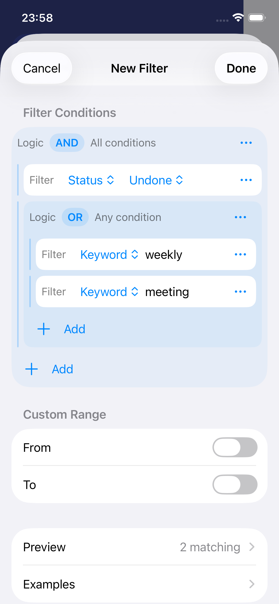  [Verification](changes/mobile-advanced-filter-2026-11-15.md) |
| T15 | Add Tag | Partial | Add Tag title/check, blank-name validation, real inline palette/current selection, retained custom color and Parent Tag. Exact reference colors/geometry unverified. | **Reference withheld** [Observed reference inventory](ticktick-spec/mobile-surface-inventory-2026-11-14.md) | 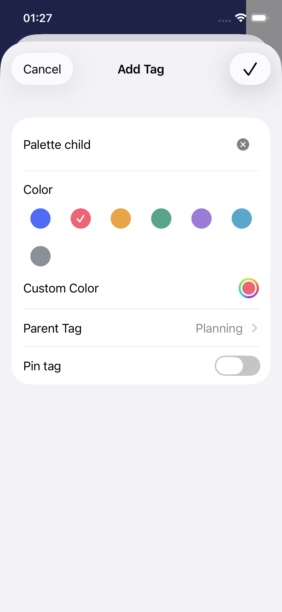  [Verification](changes/mobile-add-tag-2026-11-15.md) |
| T16 | Parent Tag | Partial | Explicit None/radio choices and cycle-safe staged selection implemented; exact geometry/order unverified. | **Screenshot missing** [Reference inventory](ticktick-spec/mobile-surface-inventory-2026-11-14.md) |  [Receipt](changes/mobile-parent-tag-2026-11-15.md) |
| T17 | Quick-add composer | Partial | Compact core actions and More→advanced form; keyboard/height and fine layout still differ. |  iPhone Mirroring, 2026-11-17. [Observed reference inventory](ticktick-spec/mobile-surface-inventory-2026-11-14.md) |  [Receipt](changes/mobile-compact-capture-2026-11-15.md) |

## Capture provenance

Click a table image for original resolution. [Machine-readable provenance and SHA-256 manifest](assets/mobile-parity/2026-11-15/manifest.json). Portable TickTick reference provenance lives in the [2026-11-17 reference manifest](assets/mobile-parity/2026-11-17/reference/manifest.json). Capture runtime metadata is limited to what the linked QA receipt records; no unrecorded device, build or scale is inferred. Every entry below is an owned Simulator QA screenshot (1170×2532) with a neutral fixture; none is pixel certification.

| ID | Capture source | Receipt / record | Limits |
|---|---|---|---|
| C01 | 2026-11-16 capture at source `52cd9af` on `B263E8E7` (iPhone 13 Pro, iOS 26.3.1) | [Receipt](changes/mobile-week-header-2026-11-16.md) | Clipped Sunday column, tall all-day band; header-formatting slice, not Week geometry |
| C02 | Same run, source and device as C01 | [Receipt](changes/mobile-week-header-2026-11-16.md) | Companion Year/List/Multi-Day/Multi-Week captures remain in `/private/tmp/TaskovskyWeekHeaderNative/screenshots/`; anchored-menu acceptance open |
| C03 | Historical [PR #112](https://github.com/Mental-NV/Taskovsky/pull/112) QA | [Receipt](changes/mobile-week-overview-2026-11-15.md) | Not a current-main capture |
| C04 | Historical [PR #103](https://github.com/Mental-NV/Taskovsky/pull/103) QA | [Receipt](changes/mobile-calendar-header-2026-11-14.md) | Predates subsequent Calendar layout changes; not a current-main capture |
| C05 | Hierarchy capture at source `77d6801` (integrated `024417d`); compact follow-up rendered in-row | [Receipt](changes/mobile-calendar-filter-layout-2026-11-15.md) | Hierarchy viewport cuts the lower bulk row; compact layout is approximate, not calibrated |
| C06 | 2026-11-16 captures at source `a638aed` (base `5803158`) on `B263E8E7`, neutral `calendar-options` fixture | [Receipt](changes/mobile-calendar-view-options-c06-2026-11-16.md) | Extras capture is a staged checklist-on state; declined/focus/health rows absent by scope |
| C10 | Historical [PR #115](https://github.com/Mental-NV/Taskovsky/pull/115) QA | [Receipt](changes/mobile-calendar-options-navigation-2026-11-15.md) | Six further captures (tiles, Week Modern/Classic, Year Show/Hide, legacy Filled) are linked from the C10 row; see also the [style-tiles receipt](changes/mobile-calendar-style-tiles-2026-11-16.md) |
| C11 | Historical [PR #115](https://github.com/Mental-NV/Taskovsky/pull/115) QA | [Receipt](changes/mobile-calendar-options-navigation-2026-11-15.md) | Not a current-main capture |
| C15 | Historical [PR #113](https://github.com/Mental-NV/Taskovsky/pull/113) QA | [Receipt](changes/mobile-arrange-filter-2026-11-15.md) | Not a current-main capture |
| D01 | [PR116](https://github.com/Mental-NV/Taskovsky/pull/116) checkpoint `68e6b23` | [Receipt](changes/mobile-empty-description-2026-11-15.md) | Neutral created QA task; not a matched TickTick capture |
| D04 | Checkpoint `9459da6` | [Receipt](changes/mobile-assigned-tags-2026-11-15.md) | Two native regressions passed; full 835 XCTest + 38 Swift Testing, release and signature passed; not matched visual acceptance |
| D06 | Checkpoint `8b6da8b` | [Receipt](changes/mobile-move-hierarchy-2026-11-15.md) | Five native regressions and full 835 XCTest + 38 Swift Testing passed; release/signature passed; matched layout and Add List follow-up unverified |
| D07 | Historical [PR #114](https://github.com/Mental-NV/Taskovsky/pull/114) QA | [Receipt](changes/mobile-schedule-tabs-2026-11-15.md) | Not a current-main capture |
| D08 | Historical [PR #114](https://github.com/Mental-NV/Taskovsky/pull/114) QA | [Receipt](changes/mobile-schedule-tabs-2026-11-15.md) | Superseded in-row by staged timed/all-day cards; [new receipt](changes/mobile-duration-cards-2026-11-16.md) |
| D10–D13 | Staged pages as rendered in-row | — | Dedicated staged pages, not anchored preset menus; D12 carries ordered derived presets with staged/reload behavior verified; all remain partial |
| T01 | Historical [PR #102](https://github.com/Mental-NV/Taskovsky/pull/102) QA | [Receipt](changes/mobile-list-row-density-2026-11-14.md) | Not a current-main capture |
| T07 | 2026-11-16 captures on this branch, `B263E8E7` | [Receipt](changes/mobile-drawer-add-2026-11-16.md) | No account, share, print or background controls; reference typography/geometry open |
| T08 | 2026-11-16 capture on this branch, `B263E8E7` | [Receipt](changes/mobile-drawer-add-2026-11-16.md) | Backdrop tap returns with no writes; anchored-popup geometry unverified |
| T12 | Checkpoint `9b8896b`, keyboard dismissed, neutral name | [Receipt](changes/mobile-list-creation-2026-11-15.md) | Focused run 48511 passed; production source unchanged from tested candidate |
| T17 | Follow-up source `a8731b6`; prior [PR120](https://github.com/Mental-NV/Taskovsky/pull/120) shell partial | [Receipt](changes/mobile-compact-capture-2026-11-15.md) · [notice-removal receipt](changes/mobile-capture-notice-2026-11-15.md) | Real software keyboard; not a matched reference capture or exact low-sheet geometry |

### Auxiliary captures outside the 46

| Capture | Source and limits |
|---|---|
|   | ROOT label removal ([receipt](changes/mobile-remove-sample-label-2026-11-16.md)); neutral QA fixtures on `B263E8E7`; neither the QA nor the ordinary header label renders and the header closes up by one caption row. Not a parity state and not counted in the 46-state denominator; no existing row changed. |
